# Analisis Invariant — Kelas Mahasiswa

# Java

## 1. Tujuan
Program `Mahasiswa` menyimpan NIM, nama, dan tiga komponen nilai (tugas, UTS, UAS). Kelas harus menjaga agar data selalu valid dan nilai akhir dihitung sesuai bobot yang ditentukan.

## 2. Daftar invariant
1. NIM tidak boleh `null` atau kosong.
2. NIM tidak dapat diubah setelah objek dibuat (`final`) dan tidak tersedia `setNim()`.
3. Nama tidak boleh `null` atau kosong.
4. Nama tidak dapat diubah setelah objek dibuat (`final`).
5. Nilai tugas harus berada pada rentang 0–100.
6. Nilai UTS harus berada pada rentang 0–100.
7. Nilai UAS harus berada pada rentang 0–100.
8. Nilai akhir dihitung dengan bobot tugas 30%, UTS 30%, dan UAS 40%.
9. Huruf mutu mengikuti aturan: nilai akhir >= 80 adalah A, >= 70 adalah B, >= 60 adalah C, >= 50 adalah D, dan selain itu E.
10. Data yang melanggar aturan ditolak dengan `IllegalArgumentException` yang menjelaskan kesalahan.

## 3. Gambar before dan after

### Before
Bagian berikut belum selesai: validasi nilai belum dilakukan, `nilaiAkhir()` selalu mengembalikan `0`, dan `hurufMutu()` selalu mengembalikan tanda tanya.

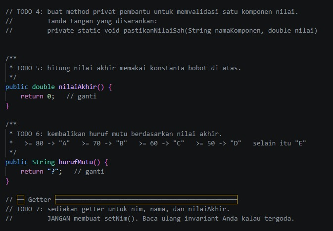

### After
Bagian berikut sudah memiliki validasi rentang nilai, perhitungan berbobot, dan penentuan huruf mutu.

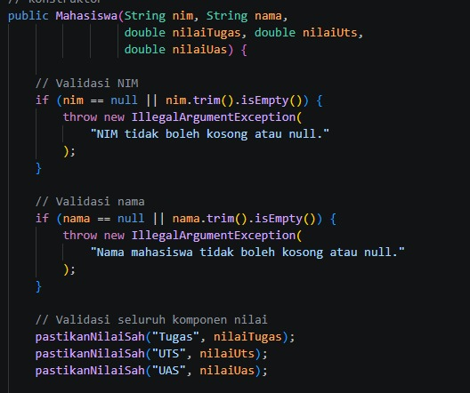
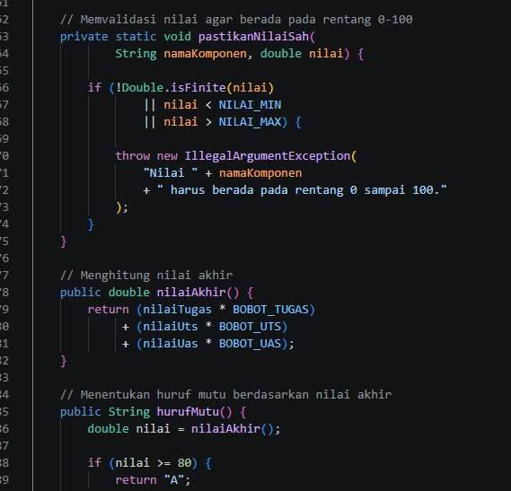
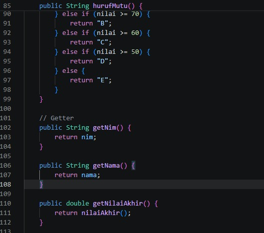

## Output
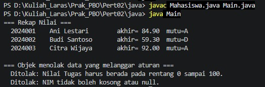

## 4. Penjelasan TODO yang diubah

| TODO | Perubahan | Alasan |
|---|---|---|
| TODO 1 | Atribut identitas memakai `private final`; nilai juga dibuat `private final` pada versi akhir ini. | Mencegah perubahan data langsung dan menjaga identitas tetap. Nilai dibuat tetap karena program tidak menyediakan fitur mengubah nilai. |
| TODO 2 | Validasi NIM menolak `null` dan teks kosong. | NIM wajib ada saat objek dibuat. |
| TODO 3 | Konstruktor memanggil `pastikanNilaiSah()` untuk nilai tugas, UTS, dan UAS sebelum menyimpan data. | Mencegah nilai di luar rentang masuk ke objek. |
| TODO 4 | Method privat `pastikanNilaiSah()` memeriksa nilai di rentang 0–100 dan menolak `NaN`/tak hingga. | Validasi dibuat satu kali agar tidak mengulang kode. |
| TODO 5 | `nilaiAkhir()` menghitung tugas × 0,30 + UTS × 0,30 + UAS × 0,40. | Mengikuti bobot pada deskripsi soal. |
| TODO 6 | `hurufMutu()` menggunakan kondisi berurutan dari A sampai E. | Menghasilkan mutu sesuai nilai akhir. |
| TODO 7 | Getter `getNim()`, `getNama()`, dan `getNilaiAkhir()` disediakan; `setNim()` tidak dibuat. | Data dapat dibaca melalui method tanpa membuka akses perubahan NIM. |

## 5. Rumus nilai akhir

```text
Nilai akhir = (Tugas × 0.30) + (UTS × 0.30) + (UAS × 0.40)
```

Contoh Ani:
`(85 × 0.30) + (78 × 0.30) + (90 × 0.40) = 84.9`, sehingga huruf mutunya `A`.

## 6. Kesimpulan
Invariant dijaga melalui enkapsulasi, atribut `private` dan `final`, validasi pada konstruktor, serta method perhitungan yang menggunakan konstanta bobot. Dengan demikian, objek `Mahasiswa` tidak dapat dibuat menggunakan NIM atau nilai yang tidak valid.

# PHP

## 1. Tujuan
Kelas `Mahasiswa` menyimpan NIM, nama, nilai tugas, nilai UTS, dan nilai UAS. Implementasi PHP ini menerapkan enkapsulasi agar objek hanya dapat dibuat dengan data yang memenuhi aturan.

## 2. Daftar invariant
1. NIM tidak boleh kosong atau hanya berisi spasi.
2. NIM tidak dapat diubah setelah objek dibuat karena properti memakai `readonly`.
3. Nama tidak boleh kosong atau hanya berisi spasi.
4. Nama tidak dapat diubah setelah objek dibuat karena properti memakai `readonly`.
5. Nilai tugas harus berada pada rentang 0 sampai 100.
6. Nilai UTS harus berada pada rentang 0 sampai 100.
7. Nilai UAS harus berada pada rentang 0 sampai 100.
8. Nilai akhir dihitung dengan bobot tugas 30%, UTS 30%, dan UAS 40%.
9. Huruf mutu berdasarkan nilai akhir: A untuk >= 80, B untuk >= 70, C untuk >= 60, D untuk >= 50, dan E untuk nilai di bawah 50.
10. Data yang melanggar aturan ditolak dengan `InvalidArgumentException`.
11. Tidak ada setter untuk NIM, nama, atau nilai; nilai disimpan sebagai `readonly` agar invariant tetap terjaga.

## 3. Gambar before dan after

### Before
Pada versi awal, method validasi belum diisi, nilai akhir selalu `0`, dan huruf mutu selalu `?`. Deklarasi `public const float` juga dapat menimbulkan parse error jika PHP yang dipakai lebih lama dari PHP 8.3.

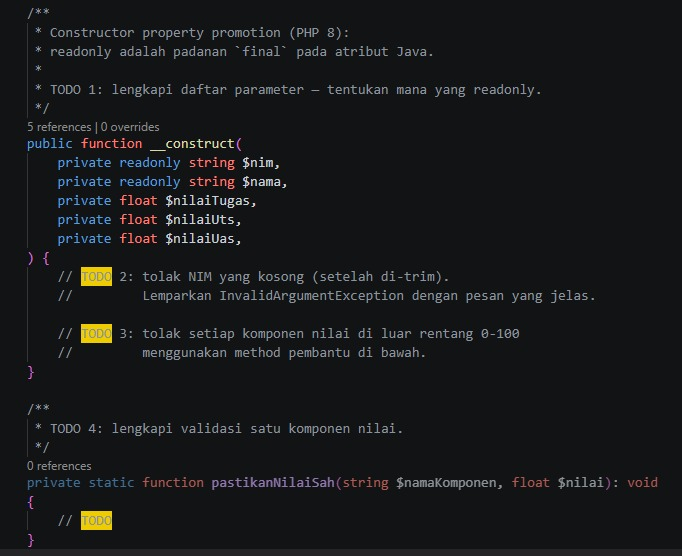
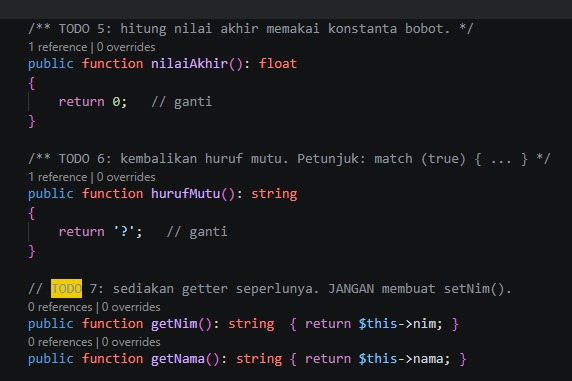

### After
Versi perbaikan melengkapi validasi nilai, menghitung nilai akhir berdasarkan konstanta bobot, menentukan huruf mutu, dan menggunakan deklarasi konstanta tanpa tipe (`public const`) agar kompatibel dengan PHP 8.1+.

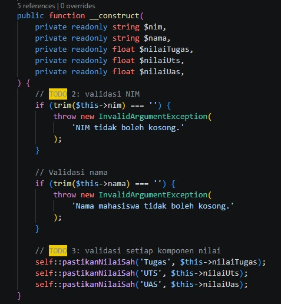
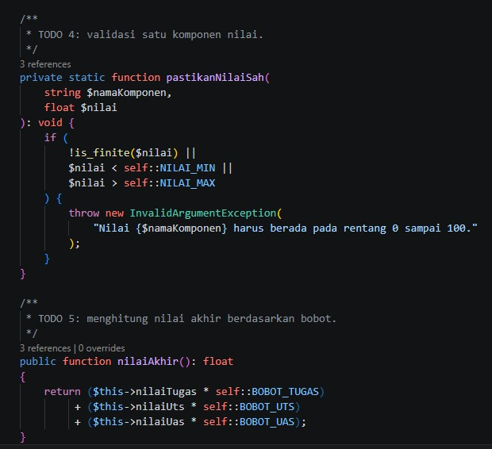
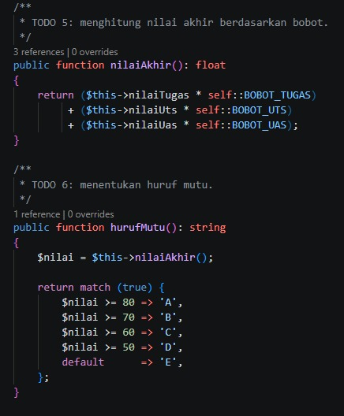
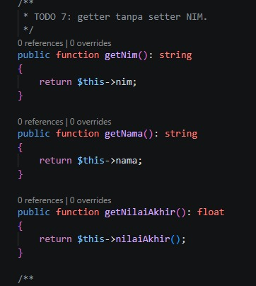

### Output
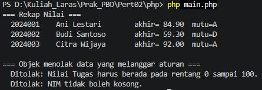

## 4. Penjelasan TODO yang diubah

| TODO | Perubahan | Tujuan |
|---|---|---|
| TODO 1 | Properti NIM dan nama dibuat `private readonly`; nilai juga `private readonly` pada implementasi akhir. | Data tidak dapat diubah setelah objek dibuat. |
| TODO 2 | `trim($this->nim) === ''` menghasilkan `InvalidArgumentException` jika NIM kosong. | Mencegah identitas tanpa NIM. |
| TODO 3 | Konstruktor memanggil `pastikanNilaiSah()` untuk tugas, UTS, dan UAS. | Semua nilai diperiksa sebelum objek selesai dibuat. |
| TODO 4 | Method pembantu memeriksa `is_finite()` serta batas minimum dan maksimum. | Menolak nilai di luar 0–100 termasuk `INF` dan `NAN`. |
| TODO 5 | `nilaiAkhir()` mengalikan setiap nilai dengan konstanta bobot yang sesuai. | Perhitungan mengikuti ketentuan soal. |
| TODO 6 | `hurufMutu()` memakai `match (true)` untuk memilih A–E. | Menghasilkan huruf mutu dari nilai akhir. |
| TODO 7 | Getter `getNim()`, `getNama()`, dan `getNilaiAkhir()` disediakan tanpa setter. | Data dapat dibaca tanpa membuka akses perubahan. |
| Perbaikan kompatibilitas | Menghapus tipe `float` setelah `const`. | Menghindari parse error pada PHP sebelum 8.3; `readonly` dan `match` tetap memerlukan PHP 8.1+. |

## 5. Rumus nilai akhir

```text
Nilai akhir = (Tugas × 0.30) + (UTS × 0.30) + (UAS × 0.40)
```

Contoh Ani:
`(85 × 0.30) + (78 × 0.30) + (90 × 0.40) = 84.9`, sehingga huruf mutunya `A`.

## 6. Kesimpulan
Invariant diimplementasikan melalui properti `private readonly`, validasi di konstruktor, method validasi terpusat, dan perhitungan berdasarkan konstanta bobot. Untuk menjalankan kode, gunakan PHP 8.1 atau lebih baru dan deklarasikan konstanta sebagai `public const BOBOT_TUGAS = 0.30;` tanpa tipe `float`.

