# Analisis Invariant — Kelas RekeningBank

# Java

## 1. Tujuan
Program `RekeningBank` menerapkan konsep enkapsulasi, constructor berdelegasi, anggota statis (`static`), dan konstanta (`static final`). Kelas ini mengelola nomor rekening, nama pemilik, serta saldo rekening, sekaligus memastikan operasi transaksi tidak melanggar aturan.

## 2. Daftar invariant
1. Saldo rekening tidak pernah negatif.
2. Nomor rekening tidak boleh kosong.
3. Nomor rekening tidak dapat diubah setelah objek dibuat karena atribut `nomor` menggunakan `final`.
4. Setoran harus memiliki jumlah lebih besar dari nol.
5. Penarikan harus memiliki jumlah lebih besar dari nol.
6. Penarikan tidak boleh melebihi saldo yang tersedia.
7. Penarikan dalam satu transaksi tidak boleh melebihi batas maksimum.
8. Biaya administrasi tidak boleh menyebabkan saldo menjadi negatif.
9. Penghitung jumlah rekening bersifat `static` dan dipakai bersama oleh semua objek.
10. Penghitung bertambah satu kali untuk setiap objek rekening yang berhasil dibuat.
11. Bunga tahunan dihitung berdasarkan pokok dikalikan konstanta bunga tahunan.

## 3. Gambar before dan after

### Before

Pada versi awal, konstanta bunga, biaya administrasi, dan batas penarikan belum dideklarasikan. Penghitung jumlah rekening belum dibuat, constructor ringkas belum mendelegasikan ke constructor lengkap, dan beberapa method transaksi serta method statis masih berisi TODO.

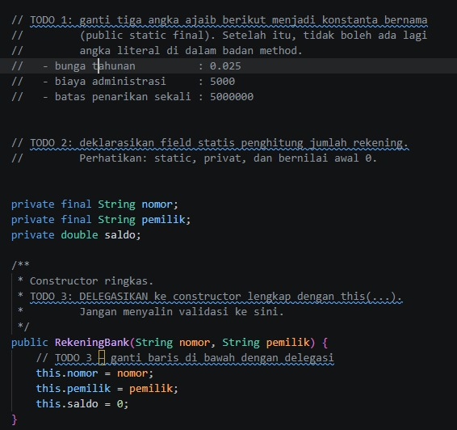

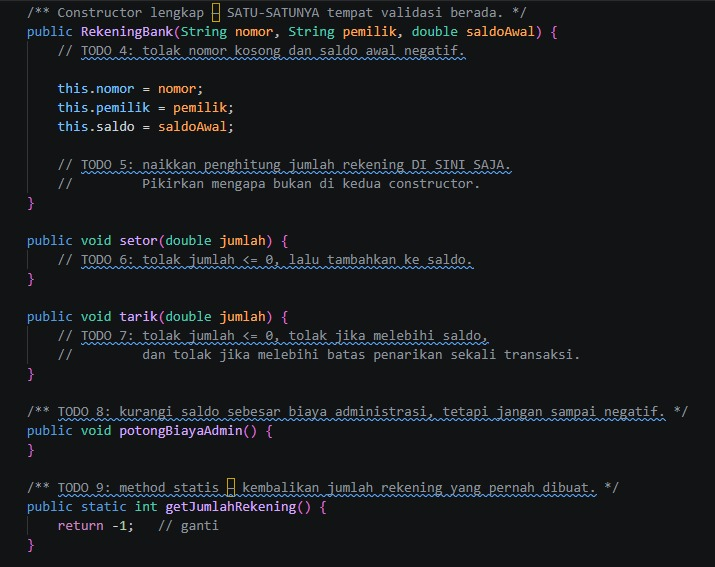

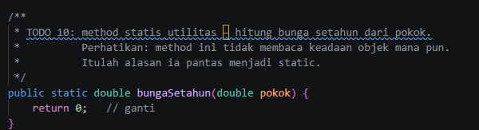


### After

Versi perbaikan menggunakan konstanta bernama, field `static` untuk menghitung jumlah rekening, dan constructor berdelegasi dengan `this(nomor, pemilik, 0)`. Constructor lengkap memvalidasi nomor rekening dan saldo awal sebelum menghitung rekening yang berhasil dibuat. Method `setor()` dan `tarik()` memvalidasi jumlah transaksi, `potongBiayaAdmin()` menjaga saldo agar tidak negatif, serta method statis mengembalikan jumlah rekening dan menghitung bunga tahunan.

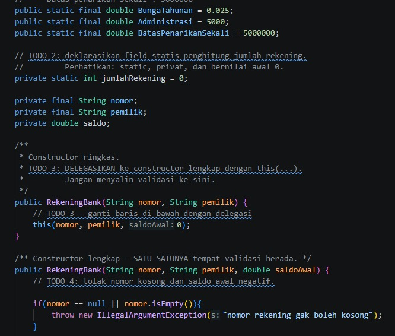

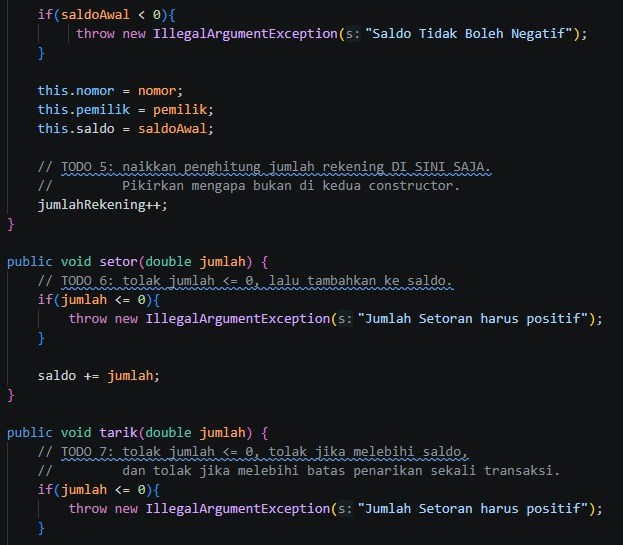

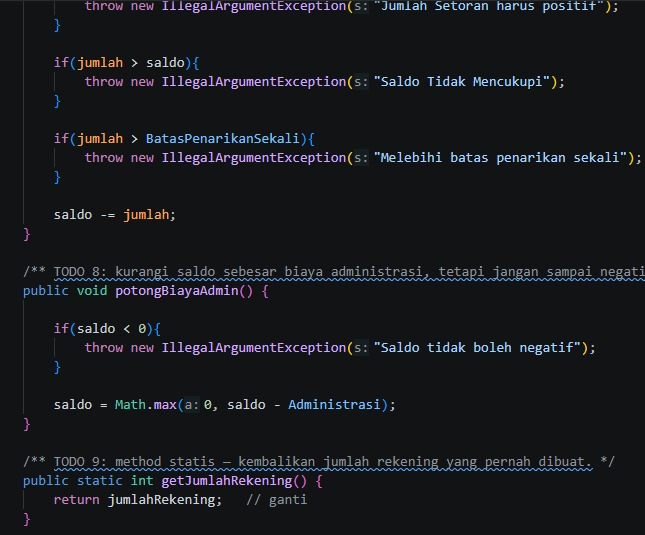

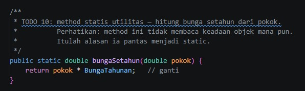

### Output

Output program menunjukkan jumlah rekening awal, daftar rekening, jumlah rekening setelah tiga objek dibuat, hasil operasi setoran, penolakan penarikan yang tidak valid, pemotongan biaya administrasi yang tidak membuat saldo negatif, dan perhitungan bunga tahunan.

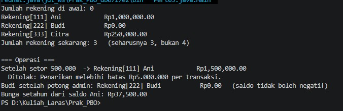


## 4. Penjelasan TODO yang diubah

| TODO | Perubahan yang diperlukan | Alasan |
|---|---|---|
| TODO 1 | Membuat konstanta bernama untuk bunga tahunan (`0.025`), biaya administrasi (`5000`), dan batas penarikan (`5000000`). | Menghilangkan angka ajaib dan memperjelas maksud nilai. |
| TODO 2 | Membuat field penghitung, misalnya `private static int jumlahRekening = 0;`. | Semua objek menggunakan penghitung yang sama. |
| TODO 3 | Constructor ringkas memanggil `this(nomor, pemilik, 0);` sebagai baris pertama. | Validasi dan inisialisasi cukup dilakukan di satu constructor. |
| TODO 4 | Constructor lengkap menolak nomor rekening kosong atau `null`, serta saldo awal negatif. | Mencegah objek dibuat dengan data yang melanggar invariant. |
| TODO 5 | Menambah `jumlahRekening` satu kali di constructor lengkap setelah validasi berhasil. | Menghindari hitungan ganda dan tidak menghitung objek yang gagal dibuat. |
| TODO 6 | `setor(jumlah)` menolak jumlah `<= 0`, lalu menambahkan jumlah ke saldo. | Setoran harus positif. |
| TODO 7 | `tarik(jumlah)` menolak jumlah `<= 0`, jumlah melebihi saldo, atau jumlah di atas batas transaksi. | Mencegah saldo negatif dan menegakkan batas penarikan. |
| TODO 8 | `potongBiayaAdmin()` mengurangi biaya administrasi hanya jika saldo mencukupi, atau menjaga saldo tetap tidak negatif sesuai aturan implementasi. | Biaya administrasi tidak boleh melanggar invariant saldo. |
| TODO 9 | `getJumlahRekening()` mengembalikan nilai `jumlahRekening`. | Menyediakan jumlah rekening tanpa bergantung pada objek tertentu. |
| TODO 10 | `bungaSetahun(pokok)` menghitung `pokok * BUNGA_TAHUNAN`. | Method statis dapat menghitung bunga tanpa membaca keadaan objek tertentu. |

## 5. Penjelasan constructor berdelegasi

Constructor ringkas seharusnya memanggil constructor lengkap:

```java
public RekeningBank(String nomor, String pemilik) {
    this(nomor, pemilik, 0);
}
```

Dengan cara ini, validasi hanya berada di constructor lengkap. Setiap objek yang berhasil dibuat melewati jalur inisialisasi yang sama, dan penghitung rekening hanya dinaikkan satu kali.

## 6. Rumus bunga tahunan

```text
Bunga = pokok × bunga tahunan
```

Contoh jika saldo Ani setelah setoran adalah Rp1.500.000:

```text
Bunga = 1.500.000 × 0,025
      = Rp37.500
```

## 7. Penjelasan output `Main.java`

- Jumlah rekening di awal adalah `0`.
- Setelah tiga objek berhasil dibuat, jumlah rekening menjadi `3`, bukan `4`, karena constructor ringkas mendelegasikan pembuatan ke constructor lengkap dan penghitung hanya dinaikkan di satu tempat.
- Setoran Rp500.000 menambah saldo Ani.
- Penarikan Rp9.999.999 ditolak karena melampaui saldo dan/atau batas transaksi.
- Pemotongan biaya administrasi tidak boleh membuat saldo negatif.
- Bunga setahun dihitung menggunakan `RekeningBank.bungaSetahun(a.getSaldo())`.

## 8. Kesimpulan
Invariant `RekeningBank` dijaga melalui atribut `private`, nomor rekening `final`, validasi pada constructor lengkap, pemeriksaan transaksi, dan konstanta bernama. Constructor berdelegasi mencegah duplikasi validasi, sedangkan `static` digunakan untuk data dan utilitas yang dimiliki bersama oleh kelas, seperti penghitung rekening dan perhitungan bunga tahunan.

# PHP

# Analisis Invariant — Kelas RekeningBank (PHP)

## 1. Tujuan
Kelas `RekeningBank` menerapkan enkapsulasi, konstanta, properti statis, default parameter, dan named constructor (static factory). Kelas menyimpan nomor rekening, pemilik, dan saldo, serta menjaga agar transaksi tidak melanggar aturan.

## 2. Daftar invariant
1. Nomor rekening tidak boleh kosong atau hanya berisi spasi.
2. Nomor rekening dan nama pemilik tidak dapat diubah setelah objek dibuat karena menggunakan `readonly`.
3. Saldo awal tidak boleh negatif atau berupa nilai non-finite seperti `INF` dan `NAN`.
4. Saldo rekening tidak pernah negatif.
5. Setoran harus lebih besar dari nol.
6. Penarikan harus lebih besar dari nol.
7. Penarikan tidak boleh melebihi saldo yang tersedia.
8. Penarikan satu kali transaksi tidak boleh melebihi batas penarikan.
9. Biaya administrasi tidak boleh menyebabkan saldo menjadi negatif.
10. Penghitung rekening adalah properti `static`, sehingga dipakai bersama oleh semua objek.
11. Penghitung hanya bertambah setelah objek berhasil melewati validasi constructor.
12. Bunga tahunan dihitung dari pokok dikalikan konstanta bunga.

## 3. Gambar before dan after

### Before

Pada versi awal, bunga, biaya administrasi, dan batas penarikan disimpan sebagai properti publik biasa, bukan konstanta. Penghitung jumlah rekening belum dibuat, constructor belum melakukan validasi, named constructor masih melempar `RuntimeException`, dan method transaksi serta method statis belum dilengkapi.

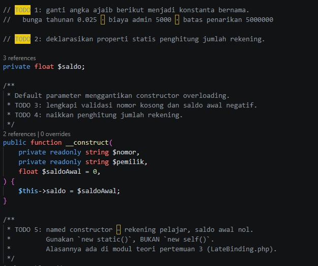
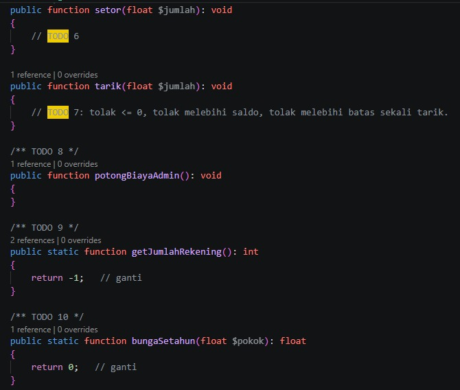

### After

Versi perbaikan mengganti angka ajaib dengan konstanta bernama, menambahkan penghitung rekening `static`, memvalidasi nomor, pemilik, dan saldo awal, serta menambah penghitung hanya setelah validasi berhasil. Named constructor memakai `new static()` agar mendukung late static binding. Method setor dan tarik memvalidasi jumlah transaksi, biaya administrasi menjaga saldo tetap tidak negatif, dan method statis menghitung jumlah rekening serta bunga tahunan.

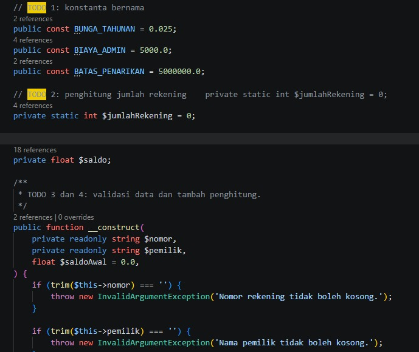
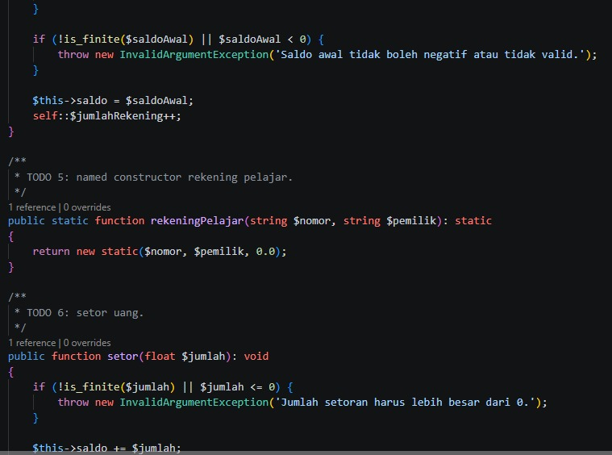
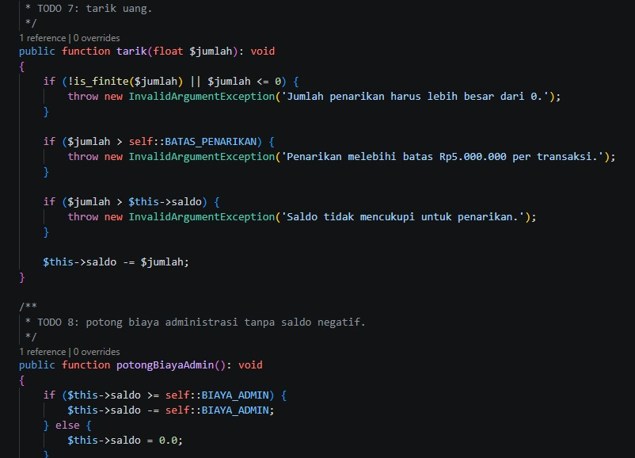
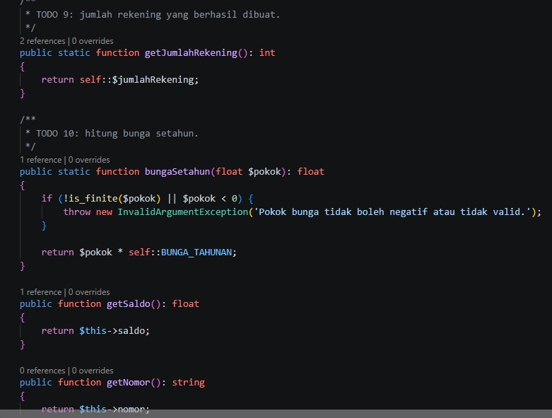

### Output

Jalankan program penguji `main.php` setelah kode kelas disimpan. Simpan screenshot output terminal dengan nama `output-php.jpeg` di folder `images`, lalu gunakan gambar berikut untuk menampilkannya:

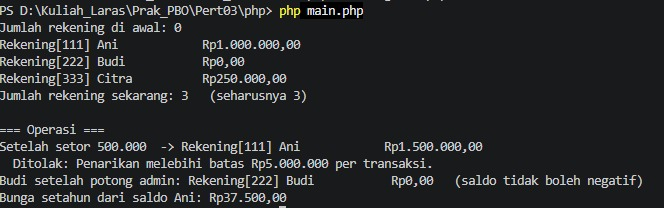


## 4. Penjelasan TODO yang diubah

| TODO | Perubahan | Tujuan |
|---|---|---|
| TODO 1 | Mengganti properti publik `$bungatahunan`, `$biayaadmin`, dan `$bataspenarikan` menjadi konstanta `BUNGA_TAHUNAN`, `BIAYA_ADMIN`, dan `BATAS_PENARIKAN`. | Nilai kebijakan tidak mudah diubah dan tidak menjadi angka ajaib yang berulang. |
| TODO 2 | Menambahkan `private static int $jumlahRekening = 0;`. | Menyimpan satu penghitung bersama untuk semua rekening. |
| TODO 3 | Constructor menolak nomor kosong, nama pemilik kosong, dan saldo awal negatif atau tidak valid. | Objek tidak dibuat dengan data yang melanggar invariant. |
| TODO 4 | Menaikkan `self::$jumlahRekening` setelah validasi dan inisialisasi berhasil. | Rekening yang gagal dibuat tidak ikut dihitung. |
| TODO 5 | `rekeningPelajar()` mengembalikan `new static($nomor, $pemilik, 0.0)`. | Membuat rekening dengan saldo awal nol dan mempertahankan late static binding. |
| TODO 6 | `setor()` menolak jumlah tidak valid atau `<= 0`, lalu menambahkan jumlah ke saldo. | Setoran harus positif. |
| TODO 7 | `tarik()` menolak jumlah tidak valid atau `<= 0`, melebihi batas, atau melebihi saldo. | Mencegah transaksi tidak sah dan saldo negatif. |
| TODO 8 | `potongBiayaAdmin()` mengurangi biaya jika saldo cukup; jika tidak, saldo menjadi nol. | Saldo tidak pernah negatif. |
| TODO 9 | `getJumlahRekening()` mengembalikan `self::$jumlahRekening`. | Mengakses total rekening tanpa objek tertentu. |
| TODO 10 | `bungaSetahun()` mengembalikan `pokok * BUNGA_TAHUNAN` setelah validasi pokok. | Menghitung bunga dengan konstanta dan menolak pokok negatif/tidak valid. |

## 5. Default parameter dan named constructor

PHP tidak mendukung constructor overloading seperti Java. Parameter `$saldoAwal = 0.0` memungkinkan objek dibuat tanpa menyertakan saldo awal:

```php
$rekening = new RekeningBank('222', 'Budi');
```

Named constructor memberi nama yang lebih jelas pada cara pembuatan objek:

```php
$pelajar = RekeningBank::rekeningPelajar('444', 'Dina');
```

Method menggunakan `new static()`, bukan `new self()`, supaya jika kelas diturunkan, pemanggilan named constructor dapat menghasilkan objek dari kelas turunan (late static binding).

## 6. Rumus bunga tahunan

```text
Bunga = pokok × bunga tahunan
```

Contoh untuk pokok Rp1.500.000:

```text
Bunga = 1.500.000 × 0,025
      = Rp37.500
```

## 7. Catatan implementasi

- Kode ini menggunakan `readonly` dan `match` tidak digunakan; `readonly` memerlukan PHP 8.1 atau lebih baru.
- Deklarasi `public const float` memerlukan PHP 8.3 atau lebih baru. Jika lingkungan PHP kamu versi 8.1 atau 8.2, tulis konstanta tanpa tipe, misalnya `public const BUNGA_TAHUNAN = 0.025;`.
- Pastikan file penguji memanggil `require_once 'RekeningBank.php';` sesuai lokasi file.
- Jika saldo kurang dari biaya administrasi, implementasi ini menetapkan saldo menjadi nol, sesuai invariant saldo tidak negatif.

## 8. Kesimpulan
Invariant kelas `RekeningBank` dijaga melalui properti privat/readonly, validasi constructor, pemeriksaan transaksi, dan konstanta bernama. Penghitung `static` mencatat objek yang berhasil dibuat, sedangkan named constructor dengan `new static()` mendukung late static binding. Semua operasi dirancang agar saldo tidak pernah negatif.
