# Analisis Perubahan Program Pewarisan Pegawai

## 1. Tujuan

Dokumen ini membandingkan kondisi **sebelum** dan **sesudah** program pewarisan pegawai diperbaiki dan dikembangkan. Analisis `before` diambil dari file Java yang ada di `Pewarisan.zip`, sedangkan analisis `after` mengacu pada kode terbaru yang diberikan.

Fokus perubahan:
- Validasi gaji pokok agar tidak bernilai negatif.
- Memperbaiki perhitungan gaji dasar dan tunjangan pegawai tetap.
- Menjelaskan pewarisan pada pegawai kontrak.
- Menambahkan kelas `PegawaiHarian` dan `Dosen`.
- Memasukkan seluruh jenis pegawai ke daftar pada `Main`.

> Catatan: kode Java yang diberikan terdiri dari beberapa kelas `public`. Dalam proyek Java biasa, setiap kelas `public` perlu disimpan di file terpisah dengan nama yang sama, misalnya `Pegawai.java`, `PegawaiTetap.java`, `PegawaiKontrak.java`, `PegawaiHarian.java`, `Dosen.java`, dan `Main.java`.

---

## 2. `Pegawai.java`

### Before

Pada versi awal, konstruktor belum memvalidasi gaji pokok dan `hitungGaji()` selalu mengembalikan `0`.

```java
protected Pegawai(String nip, String nama, double gajiPokok) {
    // TODO 1: tolak gaji pokok negatif.

    this.nip = nip;
    this.nama = nama;
    this.gajiPokok = gajiPokok;
}

public double hitungGaji() {
    return 0;   // ganti
}
```
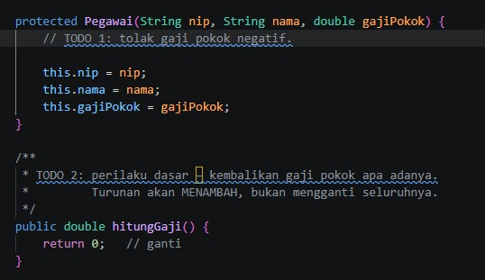

### After

```java
protected Pegawai(String nip, String nama, double gajiPokok) {
    if (gajiPokok < 0) {
        throw new IllegalArgumentException("Gaji pokok tidak boleh bernilai negatif.");
    }

    this.nip = nip;
    this.nama = nama;
    this.gajiPokok = gajiPokok;
}

public double hitungGaji() {
    return this.gajiPokok;
}
```
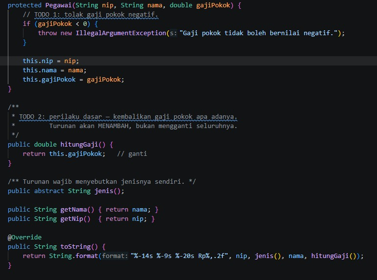

### Analisis

- Validasi `gajiPokok < 0` mencegah objek pegawai dibuat dengan gaji pokok negatif.
- `IllegalArgumentException` digunakan untuk memberi tahu bahwa argumen yang dikirim tidak valid.
- Implementasi dasar `hitungGaji()` mengembalikan gaji pokok tanpa tunjangan. Kelas turunan dapat menggunakan hasil ini dan menambahkan perhitungan khusus.
- `Pegawai` tetap `abstract`, sehingga tidak dibuat sebagai objek langsung dan setiap turunannya wajib mengimplementasikan `jenis()`.

---

## 3. `PegawaiTetap.java`

### Before

```java
@Override
public double hitungGaji() {
    return 0;
}
```
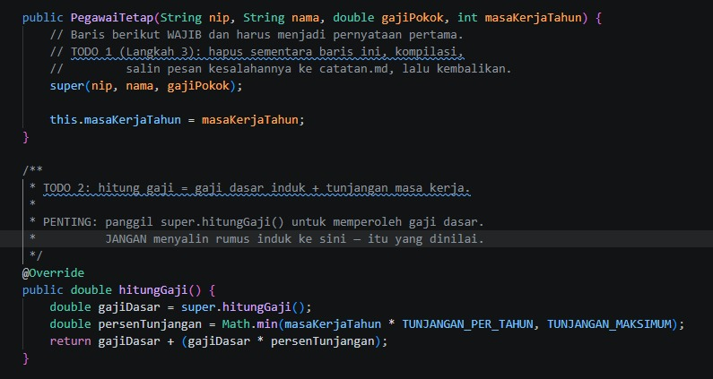

### After

```java
@Override
public double hitungGaji() {
    double gajiDasar = super.hitungGaji();
    double persenTunjangan = Math.min(
        masaKerjaTahun * TUNJANGAN_PER_TAHUN,
        TUNJANGAN_MAKSIMUM
    );
    return gajiDasar + (gajiDasar * persenTunjangan);
}
```
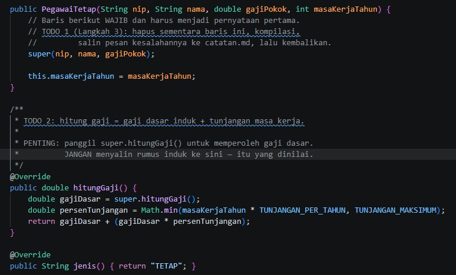

### Analisis

- `super.hitungGaji()` memanggil implementasi milik kelas induk `Pegawai` untuk memperoleh gaji pokok.
- Tunjangan masa kerja dihitung sebesar 2% per tahun.
- `Math.min()` membatasi persentase tunjangan maksimal 40%.
- Gaji akhir adalah gaji dasar ditambah tunjangan masa kerja.

**Contoh:** gaji pokok Ani Rp6.000.000 dan masa kerja 15 tahun. Tunjangan = 15 × 2% = 30%, sehingga gaji = Rp6.000.000 + Rp1.800.000 = **Rp7.800.000**.

---

## 4. `PegawaiKontrak.java`

### Before

```java
// TODO 2: pegawai kontrak TIDAK mendapat tunjangan masa kerja.
//         Apakah method hitungGaji() perlu di-override di sini?
//         Pikirkan dulu, lalu tuliskan alasannya di catatan.md.
```

### After

```java
// Pegawai kontrak tidak mendapat tunjangan masa kerja.
// Tidak perlu override hitungGaji(), karena implementasi
// dari Pegawai sudah mengembalikan gajiPokok apa adanya.
```

### Analisis

Tidak perlu membuat ulang `hitungGaji()` pada `PegawaiKontrak`. Karena kelas ini mewarisi `Pegawai` secara langsung dan tidak memiliki aturan tambahan untuk gaji, metode `hitungGaji()` dari induk sudah sesuai. Komentar dapat digunakan untuk mendokumentasikan alasan tersebut.

---

## 5. `PegawaiHarian.java` — kelas baru

### Before

Belum ada kelas `PegawaiHarian` pada berkas Java di ZIP.

### After

```java
public class PegawaiHarian extends Pegawai {

    private final int hariKerja;

    public PegawaiHarian(String nip, String nama, double upahPerHari, int hariKerja) {
        super(nip, nama, upahPerHari);

        if (hariKerja < 0) {
            throw new IllegalArgumentException("Hari kerja tidak boleh bernilai negatif.");
        }
        this.hariKerja = hariKerja;
    }

    @Override
    public double hitungGaji() {
        return this.gajiPokok * this.hariKerja;
    }

    @Override
    public String jenis() {
        return "HARIAN";
    }

    public int getHariKerja() {
        return hariKerja;
    }
}
```
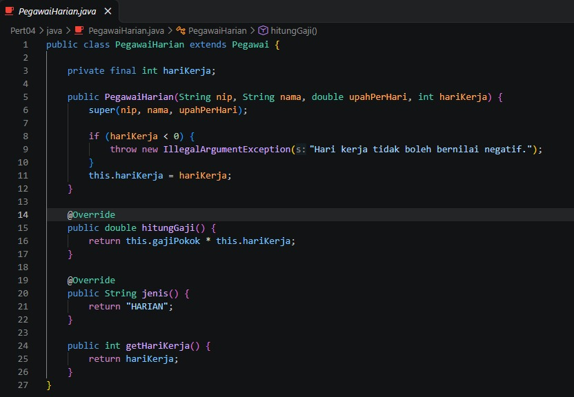

### Analisis

- Kelas ini mewarisi data umum dari `Pegawai`.
- `gajiPokok` digunakan sebagai upah per hari.
- Gaji dihitung dengan rumus **upah per hari × jumlah hari kerja**.
- Validasi memastikan jumlah hari kerja tidak negatif.
- `jenis()` mengembalikan label `HARIAN`.

---

## 6. `Dosen.java` — kelas baru

### Before

Belum ada kelas `Dosen` pada berkas Java di ZIP.

### After

```java
public class Dosen extends PegawaiTetap {

    private final double tunjanganFungsional;

    public Dosen(String nip, String nama, double gajiPokok,
                 int masaKerjaTahun, double tunjanganFungsional) {
        super(nip, nama, gajiPokok, masaKerjaTahun);

        if (tunjanganFungsional < 0) {
            throw new IllegalArgumentException(
                "Tunjangan fungsional tidak boleh bernilai negatif."
            );
        }
        this.tunjanganFungsional = tunjanganFungsional;
    }

    @Override
    public double hitungGaji() {
        return super.hitungGaji() + tunjanganFungsional;
    }

    @Override
    public String jenis() {
        return "DOSEN";
    }

    public double getTunjanganFungsional() {
        return tunjanganFungsional;
    }
}
```
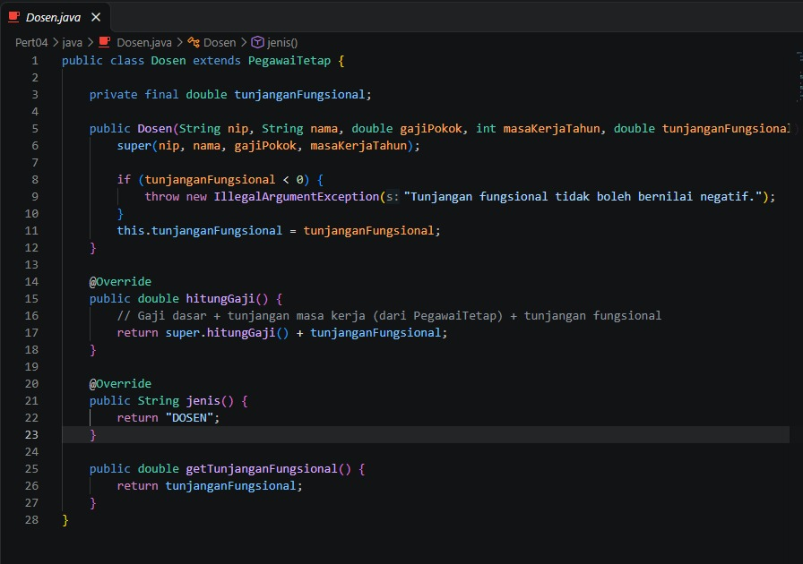

### Analisis

- `Dosen` mewarisi `PegawaiTetap`, sehingga dosen memperoleh perhitungan gaji pokok dan tunjangan masa kerja.
- `super.hitungGaji()` memanggil perhitungan gaji dari `PegawaiTetap`.
- Tunjangan fungsional ditambahkan ke hasil tersebut.
- Nilai tunjangan fungsional divalidasi agar tidak negatif.
- `jenis()` diubah menjadi `DOSEN` agar jenis pegawai tampil sesuai kelasnya.

---

## 7. `Main.java`

### Before

Daftar pegawai hanya berisi pegawai tetap dan pegawai kontrak.

```java
Pegawai[] daftar = {
    new PegawaiTetap("198701012010", "Ani Lestari", 6_000_000, 15),
    new PegawaiKontrak("K-2024-007", "Budi Santoso", 5_000_000, 12)
};
```
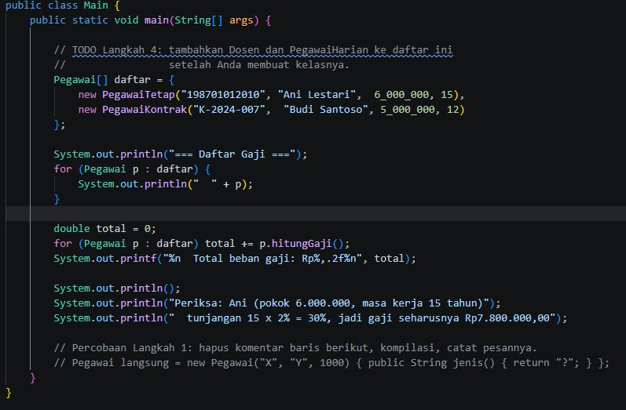

### After

```java
Pegawai[] daftar = {
    new PegawaiTetap("198701012010", "Ani Lestari", 6_000_000, 15),
    new PegawaiKontrak("K-2024-007", "Budi Santoso", 5_000_000, 12),
    new Dosen("197803122005", "Dr. Hendra", 7_500_000, 10, 2_000_000),
    new PegawaiHarian("H-2024-001", "Citra Dewi", 150_000, 22)
};
```
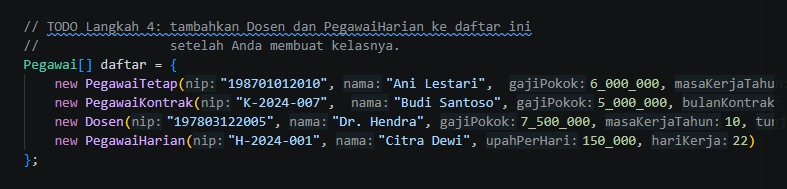

### Analisis

- Objek `Dosen` dan `PegawaiHarian` ditambahkan ke array bertipe `Pegawai[]`.
- Ini menunjukkan **polimorfisme**: satu array kelas induk dapat menyimpan objek dari beberapa kelas turunan.
- Saat `p.hitungGaji()` dipanggil, Java menjalankan implementasi sesuai tipe objek sebenarnya.
- Perulangan mencetak setiap pegawai dan menjumlahkan gaji semua pegawai untuk mendapatkan total beban gaji.

---

## 8. Output
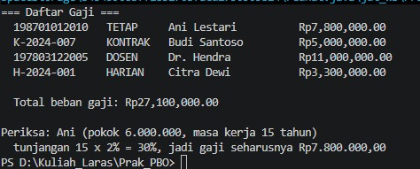


## 9. Ringkasan Before dan After

| Bagian | Before | After |
|---|---|---|
| `Pegawai` | Gaji selalu `0`; belum ada validasi gaji negatif | Gaji dasar mengembalikan `gajiPokok`; gaji negatif ditolak |
| `PegawaiTetap` | Gaji selalu `0` | Gaji pokok ditambah tunjangan masa kerja 2% per tahun, maksimal 40% |
| `PegawaiKontrak` | Alasan tidak melakukan override masih berupa TODO | Menggunakan `hitungGaji()` dari induk karena tidak ada tunjangan tambahan |
| `PegawaiHarian` | Belum tersedia | Kelas baru dengan perhitungan upah per hari × hari kerja |
| `Dosen` | Belum tersedia | Kelas baru turunan `PegawaiTetap` dengan tambahan tunjangan fungsional |
| `Main` | Hanya pegawai tetap dan kontrak | Menampilkan pegawai tetap, kontrak, dosen, dan harian |

## 10. Kesimpulan

Perubahan membuat program lebih lengkap dengan menerapkan **inheritance (pewarisan)**, **method overriding**, pemanggilan `super`, validasi input, dan **polimorfisme**. Kelas `Pegawai` menyediakan perilaku umum, sementara kelas turunannya menerapkan perhitungan gaji sesuai jenis pegawai.

Perlu diperhatikan bahwa contoh kode yang diberikan belum memvalidasi nilai negatif pada `masaKerjaTahun`, `bulanKontrak`, atau `hariKerja` selain validasi hari kerja pada `PegawaiHarian`. Jika dibutuhkan, validasi tambahan dapat dibuat agar data lebih konsisten.

# Analisis Perubahan Program Pewarisan Pegawai — PHP

## 1. Tujuan

Dokumen ini membandingkan kode PHP **sebelum** dan **sesudah** dikembangkan. Bagian `Before` mengacu pada `php/Pegawai.php` dan `php/main.php` di dalam `Pewarisan.zip`. Bagian `After` mengacu pada kode PHP terbaru yang dikirim.

Perubahan utama:
- Menambahkan validasi agar gaji pokok tidak negatif.
- Memperbaiki perhitungan gaji dasar dan gaji pegawai tetap.
- Menambahkan kelas `Dosen` dan `PegawaiHarian`.
- Menjelaskan pewarisan dan overriding metode `hitungGaji()`.
- Memperbarui daftar pegawai pada `main.php`.

---

## 2. Kelas `Pegawai`

### Before

```php
public function __construct(
    protected readonly string $nip,
    protected readonly string $nama,
    protected readonly float  $gajiPokok,
) {
    // TODO 1: tolak gaji pokok negatif.
}


/** TODO 2: kembalikan gaji pokok apa adanya. */
public function hitungGaji(): float
{
    return 0;   // ganti
}
```
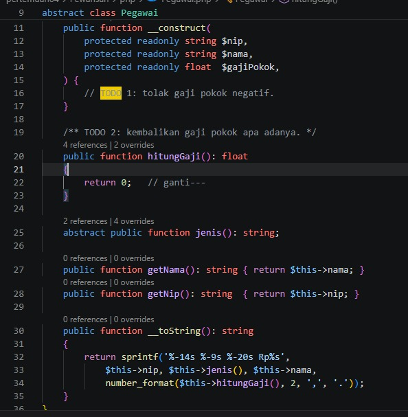

### After

```php
public function __construct(
    protected readonly string $nip,
    protected readonly string $nama,
    protected readonly float  $gajiPokok,
) {
    if ($gajiPokok < 0) {
        throw new InvalidArgumentException("Gaji Pokok tidak boleh negatif");
    }
}

public function hitungGaji(): float
{
    return $this->gajiPokok;
}
```
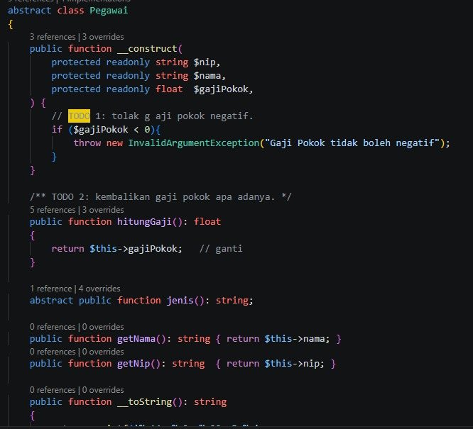

### Analisis

- Sebelum perubahan, belum ada validasi gaji negatif dan `hitungGaji()` selalu menghasilkan `0`.
- Sesudah perubahan, gaji negatif ditolak dengan `InvalidArgumentException`.
- `hitungGaji()` mengembalikan gaji pokok sebagai perhitungan dasar.
- Properti `protected readonly` membuat properti dapat diakses kelas turunan, tetapi nilainya hanya dapat ditetapkan sekali saat inisialisasi.
- Kelas `Pegawai` tetap abstrak sehingga tidak dapat dibuat sebagai objek langsung dan mewajibkan kelas turunannya menyediakan `jenis()`.

---

## 3. Kelas `PegawaiTetap`

### Before

```php
public function hitungGaji(): float
{
    return 0;   // ganti
}
```
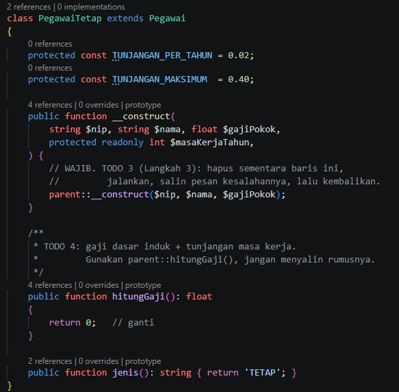

### After

```php
public function hitungGaji(): float
{
    $tunjangan = min(
        $this->masaKerjaTahun * self::TUNJANGAN_PER_TAHUN,
        self::TUNJANGAN_MAKSIMUM
    );

    return parent::hitungGaji() * (1 + $tunjangan);
}
```


### Analisis

- Tunjangan masa kerja sebesar 2% untuk setiap tahun kerja.
- `min()` membatasi tunjangan hingga maksimum 40%.
- `parent::hitungGaji()` memanggil metode dari kelas induk untuk mendapatkan gaji pokok. Ini menghindari penyalinan rumus gaji dasar.
- Rumus akhirnya adalah gaji pokok dikalikan satu ditambah persentase tunjangan.

**Contoh:** gaji pokok Rp6.000.000 dan masa kerja 15 tahun menghasilkan tunjangan 30%. Gaji akhir = Rp6.000.000 × 1,30 = **Rp7.800.000**.

---

## 4. Kelas `PegawaiKontrak`

### Before

Kelas `PegawaiKontrak` sudah memanggil konstruktor induk dan memiliki data lama kontrak, tetapi belum menjelaskan perilaku gajinya secara eksplisit. Karena `hitungGaji()` induk masih mengembalikan `0`, gaji kontrak juga menjadi `0`.

```php
class PegawaiKontrak extends Pegawai
{
    // ...
    public function jenis(): string { return 'KONTRAK'; }
    public function getBulanKontrak(): int { return $this->bulanKontrak; }
}
```
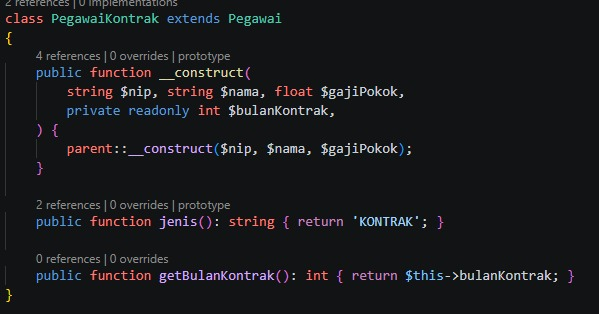

### After

Pada kode terbaru, kelas ini tetap tidak melakukan override `hitungGaji()`.

```php
class PegawaiKontrak extends Pegawai
{
    // Konstruktor memanggil parent::__construct(...)

    public function jenis(): string { return 'KONTRAK'; }

    public function getBulanKontrak(): int { return $this->bulanKontrak; }
}
```
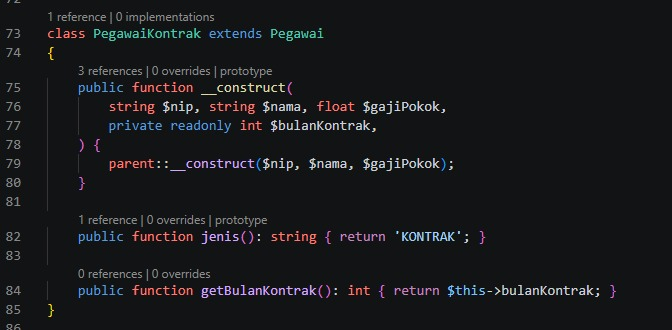

### Analisis

Tidak perlu melakukan override `hitungGaji()` karena pegawai kontrak menerima gaji pokok tanpa tunjangan masa kerja. Setelah metode pada `Pegawai` diperbaiki, `PegawaiKontrak` otomatis mewarisi perilaku tersebut.

---

## 5. Kelas `Dosen`

### Before

Di dalam ZIP, kelas `Dosen` belum dibuat. Kode hanya memiliki komentar TODO untuk menambahkannya.

```php
// TODO Langkah 4: buat kelas Dosen (turunan PegawaiTetap, punya tunjangan fungsional)
//                 dan PegawaiHarian (gaji per hari kerja) di bawah ini.
```

### After

```php
class Dosen extends PegawaiTetap
{
    protected const TUNJANGAN_FUNGSIONAL = 0.10;

    public function hitungGaji(): float
    {
        return parent::hitungGaji() * (1 + self::TUNJANGAN_FUNGSIONAL);
    }

    public function jenis(): string
    {
        return 'DOSEN';
    }
}
```
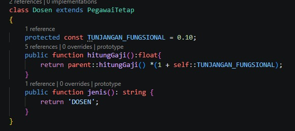

### Analisis

- `Dosen` mewarisi `PegawaiTetap`, sehingga perhitungan gaji dosen sudah mencakup tunjangan masa kerja.
- `parent::hitungGaji()` memanggil perhitungan gaji dari `PegawaiTetap`.
- Kode terbaru menambahkan tunjangan fungsional sebesar **10% dari gaji setelah tunjangan masa kerja**.
- `jenis()` mengembalikan label `DOSEN`.

**Catatan penting:** implementasi PHP ini berbeda dengan versi Java yang dikirim sebelumnya. Versi Java menggunakan nominal `tunjanganFungsional` yang diberikan melalui konstruktor, sedangkan PHP memakai persentase tetap 10%. Jadi, keduanya belum memiliki aturan tunjangan fungsional yang sama.

---

## 6. Kelas `PegawaiHarian`

### Before

Kelas `PegawaiHarian` belum tersedia dalam ZIP; keberadaannya masih berupa TODO.

### After

```php
class PegawaiHarian extends Pegawai
{
    public function __construct(
        string $nip,
        string $nama,
        float $gajiPerHari,
        private readonly int $hariKerja,
    ) {
        parent::__construct($nip, $nama, $gajiPerHari);
    }

    public function hitungGaji(): float
    {
        return parent::hitungGaji() * $this->hariKerja;
    }

    public function jenis(): string
    {
        return 'HARIAN';
    }

    public function getHariKerja(): int
    {
        return $this->hariKerja;
    }
}
```
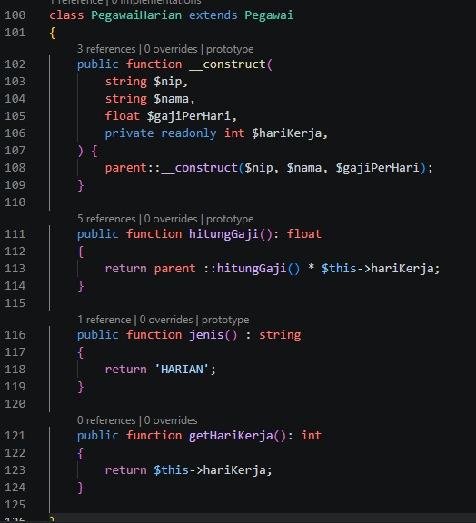


### Analisis

- `PegawaiHarian` mewarisi data umum pegawai dari `Pegawai`.
- Gaji dihitung dari upah per hari dikalikan jumlah hari kerja.
- `parent::hitungGaji()` mengambil nilai upah per hari dari kelas induk.
- `jenis()` mengembalikan label `HARIAN`.

**Catatan:** kode saat ini belum menolak `hariKerja` negatif. Sebaiknya tambahkan validasi seperti `if ($hariKerja < 0) { throw new InvalidArgumentException(...); }` di konstruktor. Validasi serupa dapat ditambahkan untuk masa kerja dan bulan kontrak bila diperlukan.

---

## 7. `main.php`

### Before

Daftar hanya memuat pegawai tetap dan pegawai kontrak.

```php
$daftar = [
    new PegawaiTetap('198701012010', 'Ani Lestari', 6_000_000, 15),
    new PegawaiKontrak('K-2024-007', 'Budi Santoso', 5_000_000, 12),
];
```
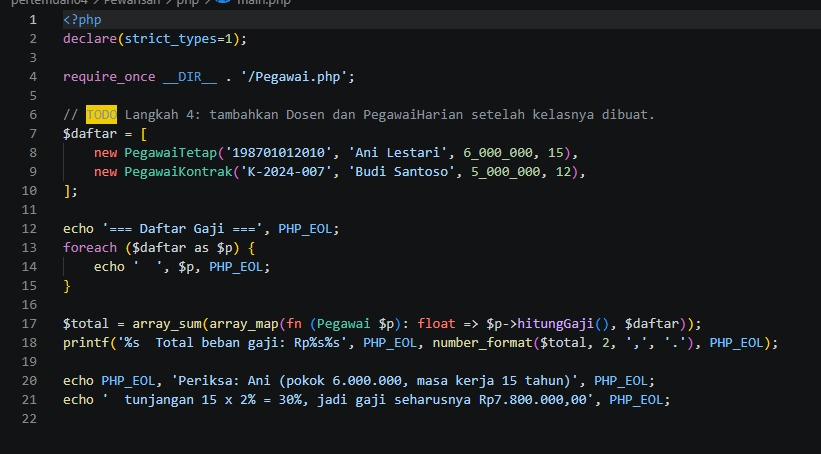


### After

Di kode PHP terbaru yang dikirim, kelas `Dosen` dan `PegawaiHarian` sudah dibuat, tetapi kode `main.php` versi terbaru belum disertakan. Agar keduanya ikut diproses, daftar dapat diperbarui menjadi:

```php
$daftar = [
    new PegawaiTetap('198701012010', 'Ani Lestari', 6_000_000, 15),
    new PegawaiKontrak('K-2024-007', 'Budi Santoso', 5_000_000, 12),
    new Dosen('197803122005', 'Dr. Hendra', 7_500_000, 10),
    new PegawaiHarian('H-2024-001', 'Citra Dewi', 150_000, 22),
];
```
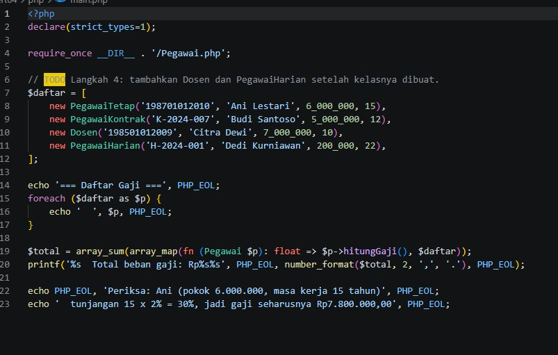


### Analisis

- Objek dari berbagai kelas turunan disimpan dalam satu array.
- Perulangan `foreach` dapat mencetak setiap objek.
- Pemanggilan `$p->hitungGaji()` menjalankan metode yang sesuai dengan kelas objek tersebut. Ini merupakan contoh **polimorfisme**.
- Baris penjumlahan total dapat tetap digunakan untuk menghitung seluruh gaji di dalam array.

---

## 8. Ringkasan Before dan After

| Bagian | Before (ZIP) | After (kode terbaru) |
|---|---|---|
| `Pegawai` | Validasi belum ada; gaji selalu `0` | Gaji negatif ditolak; gaji dasar mengembalikan gaji pokok |
| `PegawaiTetap` | Gaji selalu `0` | Tunjangan 2% per tahun, maksimum 40% |
| `PegawaiKontrak` | Mewarisi metode induk yang masih menghasilkan `0` | Mewarisi gaji pokok tanpa tunjangan masa kerja |
| `Dosen` | Belum dibuat | Turunan `PegawaiTetap`, tunjangan fungsional 10% |
| `PegawaiHarian` | Belum dibuat | Gaji per hari dikalikan hari kerja |
| `main.php` | Hanya dua jenis pegawai | Perlu menambahkan objek `Dosen` dan `PegawaiHarian` agar semuanya ditampilkan |

## 8. Output
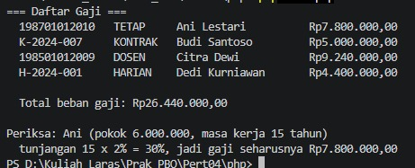

## 9. Kesimpulan

Versi PHP yang terbaru menyelesaikan TODO utama pada kelas induk dan pegawai tetap serta menambahkan dua jenis pegawai baru. Program menerapkan **inheritance**, **method overriding**, pemanggilan `parent::`, validasi input, dan **polimorfisme**.

Ada dua hal yang perlu diperhatikan:
1. `main.php` dalam ZIP belum menambahkan objek `Dosen` dan `PegawaiHarian`, jadi daftar tersebut perlu diperbarui secara terpisah.
2. Aturan tunjangan fungsional PHP (10%) berbeda dari versi Java yang menggunakan nominal tunjangan dari konstruktor. Jika kedua versi harus menghasilkan perhitungan yang sama, aturan tersebut perlu diseragamkan.
