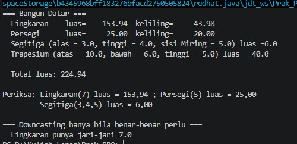
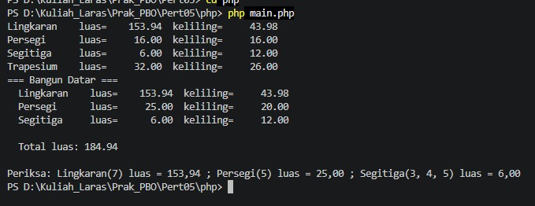

# Analisis Before–After Pertemuan 05 — Java

## 1. Sumber perbandingan

- **Before:** arsip `pertemuan05.rar`, folder `pertemuan05/`.
- **After:** arsip `Pert05(1).rar`, folder `Pert05/java/`.

Fokus materi: **polimorfisme**, kelas abstrak, overriding, upcasting, validasi konstruktor, penambahan bangun datar, dan refaktor anti-pattern.

## 2. `Lingkaran.java`

### Before

```java
public Lingkaran(double jariJari) {
    super("Lingkaran");
    // TODO 1: tolak jari-jari <= 0.
    this.jariJari = jariJari;
}

@Override public double luas()     { return 0; }
@Override public double keliling() { return 0; }
```

### After

```java
public Lingkaran(double jariJari) {
    super("Lingkaran");
    if (jariJari <= 0) {
        throw new IllegalArgumentException("Jari-jari harus lebih besar dari 0.");
    }
    this.jariJari = jariJari;
}

@Override
public double luas() {
    return Math.PI * jariJari * jariJari;
}

@Override
public double keliling() {
    return 2 * Math.PI * jariJari;
}
```

### Analisis

- Versi awal belum memvalidasi jari-jari dan kedua metode selalu mengembalikan `0`.
- Versi baru menolak jari-jari nol atau negatif.
- Rumus luas adalah \(\pi r^2\), sedangkan keliling adalah \(2\pi r\).
- `Math.PI` digunakan agar nilai π lebih akurat daripada konstanta pendekatan `3.14`.

## 3. `Persegi.java`

### Before

```java
public Persegi(double sisi) {
    super("Persegi");
    // TODO 1: tolak sisi <= 0.
    this.sisi = sisi;
}

@Override public double luas()     { return 0; }
@Override public double keliling() { return 0; }
```

### After

```java
public Persegi(double sisi) {
    super("Persegi");
    if (sisi <= 0) {
        throw new IllegalArgumentException("Sisi harus lebih besar dari 0.");
    }
    this.sisi = sisi;
}

@Override
public double luas() {
    return sisi * sisi;
}

@Override
public double keliling() {
    return 4 * sisi;
}
```

### Analisis

Versi baru memvalidasi panjang sisi, menghitung luas dengan \(sisi^2\), dan keliling dengan \(4 \times sisi\). Getter `getSisi()` juga ditambahkan agar nilai sisi dapat dibaca dari luar kelas.

## 4. `BangunDatar.java`

### Before dan After

Struktur utama kelas induk tidak berubah secara berarti: `BangunDatar` tetap `abstract`, memiliki metode abstrak `luas()` dan `keliling()`, serta `toString()` yang memanggil kedua metode tersebut.

```java
public abstract class BangunDatar {
    private final String nama;

    protected BangunDatar(String nama) {
        this.nama = nama;
    }

    public abstract double luas();
    public abstract double keliling();

    public String getNama() {
        return nama;
    }

    @Override
    public String toString() {
        return String.format(
            "%-12s luas=%10.2f  keliling=%10.2f",
            nama, luas(), keliling()
        );
    }
}
```

### Analisis

Kelas induk menetapkan kontrak yang harus dipenuhi setiap bentuk. `toString()` berada di kelas induk, tetapi saat dijalankan pada objek `Lingkaran`, `Persegi`, atau kelas turunan lain, pemanggilan `luas()` dan `keliling()` akan menjalankan implementasi objek tersebut. Ini merupakan **dynamic dispatch**, salah satu inti polimorfisme.

## 5. `Segitiga.java` — kelas baru

### Before

Kelas `Segitiga` belum ada. `Main.java` hanya memiliki TODO untuk menambahkannya.

### After

```java
public class Segitiga extends BangunDatar {
    private double alas;
    private double tinggi;
    private double sisiMiring;

    public Segitiga(double alas, double tinggi, double sisiMiring) {
        super("Segitiga");
        this.alas = alas;
        this.tinggi = tinggi;
        this.sisiMiring = sisiMiring;
    }

    @Override
    public double luas() {
        return 0.5 * alas * tinggi;
    }

    @Override
    public double keliling() {
        return alas + tinggi + sisiMiring;
    }
}
```

### Analisis

- `Segitiga` menambahkan implementasi `luas()` dan `keliling()` sesuai kontrak induk.
- Untuk data `(3, 4, 5)`, luasnya `6` dan kelilingnya `12`.
- Kelas ini juga melakukan override `toString()` untuk menampilkan detail segitiga.
- **Catatan perbaikan:** konstruktor saat ini belum memvalidasi nilai positif maupun memastikan parameter yang diberikan benar-benar membentuk segitiga. Selain itu, nama parameter `tinggi` dipakai juga sebagai salah satu sisi dalam rumus keliling; hal ini mengikuti kode saat ini, tetapi model data dapat dibuat lebih jelas bila tiga nilai tersebut dimaksudkan sebagai tiga sisi.

## 6. `Trapesium.java` — kelas baru

### Before

Kelas `Trapesium` belum tersedia; hanya ada TODO pada `Main.java`.

### After

```java
public class Trapesium extends BangunDatar {
    private double sisiAtas;
    private double sisiBawah;
    private double tinggi;
    private double sisiKiri;
    private double sisiKanan;

    public Trapesium(double sisiAtas, double sisiBawah, double tinggi,
                     double sisiKiri, double sisiKanan) {
        super("Trapesium");
        this.sisiAtas = sisiAtas;
        this.sisiBawah = sisiBawah;
        this.tinggi = tinggi;
        this.sisiKiri = sisiKiri;
        this.sisiKanan = sisiKanan;
    }

    @Override
    public double luas() {
        return 0.5 * (sisiAtas + sisiBawah) * tinggi;
    }

    @Override
    public double keliling() {
        return sisiAtas + sisiBawah + sisiKiri + sisiKanan;
    }
}
```

### Analisis

Kelas baru ini menghitung luas trapesium dengan setengah jumlah sisi sejajar dikalikan tinggi, dan keliling dengan menjumlahkan keempat sisi. `toString()` di-override agar informasi trapesium lebih spesifik. **Catatan:** konstruktor belum memvalidasi nilai positif atau konsistensi ukuran geometri.

## 7. `Main.java`

### Before

```java
BangunDatar[] daftar = {
    new Lingkaran(7),
    new Persegi(5),
    // TODO: tambahkan Segitiga
    // TODO: tambahkan Trapesium
};
```

### After

```java
BangunDatar[] daftar = {
    new Lingkaran(7),
    new Persegi(5),
    new Segitiga(3, 4, 5),
    new Trapesium(10, 6, 5, 5, 4)
};
```

### Analisis

- Dua objek baru ditambahkan tanpa mengubah pola perulangan.
- Array bertipe `BangunDatar[]` dapat menyimpan beberapa objek turunan. Ini disebut **upcasting**.
- `for (BangunDatar b : daftar)` memanggil `toString()` setiap objek.
- Perulangan total luas tetap sama; metode `luas()` yang dipanggil ditentukan oleh tipe objek sebenarnya.
- Pemeriksaan `instanceof Lingkaran` pada bagian downcasting hanya digunakan ketika program memang membutuhkan akses khusus ke `getJariJari()`.

## 8. `AntiPattern.java` dan `AntiPatternRefaktor.java`

### Before: `AntiPattern.java`

Versi awal menggunakan `Object` dan percabangan tipe:

```java
static double hitungLuas(Object bangun) {
    if (bangun instanceof LingkaranData l) {
        return Math.PI * l.r() * l.r();
    } else if (bangun instanceof PersegiData p) {
        return p.sisi() * p.sisi();
    } else if (bangun instanceof SegitigaData s) {
        return 0.5 * s.alas() * s.tinggi();
    }
    throw new IllegalArgumentException("Bangun tidak dikenal: " + bangun);
}
```

### After: `AntiPatternRefaktor.java`

Versi baru mendefinisikan interface `Bangun` dengan metode `luas()`, kemudian setiap record mengimplementasikannya.

```java
interface Bangun {
    double luas();
}

record LingkaranData(double r) implements Bangun {
    @Override
    public double luas() {
        return Math.PI * r * r;
    }
}
```

### Analisis

Versi anti-pattern menaruh semua rumus di satu metode dan harus diubah setiap kali bentuk baru ditambahkan. Versi refaktor memindahkan rumus ke masing-masing tipe. Perulangan cukup memanggil `b.luas()` tanpa `if/else` untuk memeriksa jenis objek. Ini lebih mudah dikembangkan dan merupakan contoh polimorfisme melalui interface.

## 9. Output


## 10. Ringkasan Before dan After

| Bagian | Before (`pertemuan05`) | After (`Pert05`) |
|---|---|---|
| Lingkaran | Validasi belum ada; luas dan keliling `0` | Validasi jari-jari dan rumus lengkap |
| Persegi | Validasi belum ada; luas dan keliling `0` | Validasi sisi dan rumus lengkap |
| Segitiga | Belum dibuat | Kelas baru dengan luas dan keliling |
| Trapesium | Belum dibuat | Kelas baru dengan luas dan keliling |
| Main | Baru Lingkaran dan Persegi; dua TODO | Menambahkan Segitiga dan Trapesium |
| Anti-pattern | Percabangan `instanceof` menghitung luas | Ada versi refaktor dengan interface `Bangun` |
| Polimorfisme | Kerangka abstrak sudah disediakan | Implementasi bentuk dan daftar objek lebih lengkap |

## 11. Kesimpulan

Perubahan Pert05 melengkapi perhitungan luas dan keliling Lingkaran serta Persegi, menambahkan Segitiga dan Trapesium, dan memperlihatkan bagaimana objek berbeda dapat diproses melalui referensi kelas induk. Contoh `AntiPatternRefaktor` juga menunjukkan manfaat memindahkan perilaku ke masing-masing tipe daripada menggunakan percabangan tipe yang panjang.

Saran lanjutan: tambahkan validasi konstruktor untuk Segitiga dan Trapesium serta pertimbangkan menjadikan field Segitiga dan Trapesium `private final` agar konsisten dengan kelas lain.

# Analisis Before–After Pertemuan 05 — PHP

## 1. Sumber perbandingan

- **Before:** arsip `pertemuan05.rar`, folder `pertemuan05/`.
- **After:** arsip `Pert05(1).rar`, folder `Pert05/php/`.

Fokus materi: kelas abstrak, pewarisan, overriding, validasi konstruktor, polimorfisme, dan penambahan tipe bangun datar serta notifikasi.

## 2. Kelas `BangunDatar`

### Before

```php
abstract class BangunDatar
{
    public function __construct(private readonly string $nama) {}

    abstract public function luas(): float;
    abstract public function keliling(): float;

    public function getNama(): string { return $this->nama; }

    public function __toString(): string
    {
        return sprintf('%-12s luas=%10.2f  keliling=%10.2f',
            $this->nama, $this->luas(), $this->keliling());
    }
}
```

### After

Kelas `BangunDatar` masih menyediakan kontrak `luas()` dan `keliling()`, tetapi properti nama sekarang dideklarasikan terpisah dan ditetapkan melalui konstruktor.

```php
abstract class BangunDatar
{
    private string $nama;

    public function __construct(string $nama)
    {
        $this->nama = $nama;
    }

    abstract public function luas(): float;
    abstract public function keliling(): float;

    public function getNama(): string { return $this->nama; }

    public function __toString(): string
    {
        return sprintf('%-12s luas=%10.2f  keliling=%10.2f',
            $this->nama, $this->luas(), $this->keliling());
    }
}
```

### Analisis

Struktur perilakunya tetap sama: kelas abstrak menentukan bahwa setiap bangun harus memiliki metode `luas()` dan `keliling()`. `__toString()` memanggil metode tersebut sehingga hasilnya mengikuti implementasi kelas turunan. Perbedaan implementasi properti adalah `nama` tidak lagi dideklarasikan sebagai `readonly` pada versi setelahnya.

## 3. Kelas `Lingkaran`

### Before

```php
public function __construct(private readonly float $jariJari)
{
    parent::__construct('Lingkaran');
    // TODO 1: tolak jari-jari <= 0.
}

public function luas(): float     { return 0; }
public function keliling(): float { return 0; }
```

### After

```php
public function __construct(float $jariJari)
{
    parent::__construct('Lingkaran');

    if ($jariJari <= 0) {
        throw new InvalidArgumentException(
            "Jari-jari harus lebih besar dari 0."
        );
    }

    $this->jariJari = $jariJari;
}

public function luas(): float
{
    return M_PI * ($this->jariJari ** 2);
}

public function keliling(): float
{
    return 2 * M_PI * $this->jariJari;
}
```

### Analisis

- Versi awal belum memvalidasi jari-jari dan hasil luas/keliling masih `0`.
- Versi baru menolak jari-jari nol atau negatif.
- Luas dihitung dengan \(\pi r^2\), keliling dengan \(2\pi r\).
- Properti `jariJari` disimpan setelah validasi dan tersedia melalui `getJariJari()`.

## 4. Kelas `Persegi`

### Before

```php
public function __construct(private readonly float $sisi)
{
    parent::__construct('Persegi');
    // TODO 1: tolak sisi <= 0.
}

public function luas(): float     { return 0; }
public function keliling(): float { return 0; }
```

### After

```php
public function __construct(float $sisi)
{
    parent::__construct('Persegi');

    if ($sisi <= 0) {
        throw new InvalidArgumentException(
            "Panjang sisi harus lebih besar dari 0."
        );
    }

    $this->sisi = $sisi;
}

public function luas(): float
{
    return $this->sisi * $this->sisi;
}

public function keliling(): float
{
    return 4 * $this->sisi;
}
```

### Analisis

Versi baru menolak panjang sisi yang tidak valid, menghitung luas sebagai sisi dikali sisi, dan keliling sebagai empat kali sisi. Getter `getSisi()` juga ditambahkan.

## 5. Kelas `Segitiga` — kelas baru

### Before

Kelas Segitiga belum dibuat; hanya ada TODO yang meminta pembuatan kelas dengan tiga sisi, rumus Heron, dan validasi bentuk segitiga.

### After

```php
class Segitiga extends BangunDatar
{
    private float $a;
    private float $b;
    private float $c;

    public function __construct(float $a, float $b, float $c)
    {
        parent::__construct('Segitiga');

        if ($a <= 0 || $b <= 0 || $c <= 0) {
            throw new InvalidArgumentException(
                "Setiap sisi segitiga harus bernilai lebih besar dari 0."
            );
        }

        if ($a + $b <= $c || $a + $c <= $b || $b + $c <= $a) {
            throw new InvalidArgumentException(
                "Kombinasi sisi tidak memenuhi syarat segitiga."
            );
        }

        $this->a = $a;
        $this->b = $b;
        $this->c = $c;
    }

    public function luas(): float
    {
        $s = $this->keliling() / 2;
        return sqrt($s * ($s - $this->a) * ($s - $this->b) * ($s - $this->c));
    }

    public function keliling(): float
    {
        return $this->a + $this->b + $this->c;
    }
}
```

### Analisis

- Konstruktor memvalidasi setiap sisi harus positif dan jumlah dua sisi harus lebih besar dari sisi ketiga.
- Keliling adalah jumlah ketiga sisi.
- Luas memakai rumus Heron, dengan \(s\) sebagai setengah keliling.
- Untuk sisi 3, 4, dan 5, luasnya 6 dan kelilingnya 12.

## 6. Kelas `Trapesium` — kelas baru

### Before

Kelas Trapesium belum tersedia; hanya ada TODO.

### After

```php
class Trapesium extends BangunDatar
{
    // Properti: dua sisi sejajar, dua sisi miring, dan tinggi.

    public function luas(): float
    {
        return 0.5 * ($this->sisiSejajarA + $this->sisiSejajarB)
            * $this->tinggi;
    }

    public function keliling(): float
    {
        return $this->sisiSejajarA + $this->sisiSejajarB
            + $this->sisiMiringC + $this->sisiMiringD;
    }
}
```

### Analisis

- Kelas baru memiliki dua sisi sejajar, dua sisi miring, dan tinggi.
- Konstruktor menolak parameter yang bernilai nol atau negatif.
- Luas dihitung dengan setengah jumlah dua sisi sejajar dikalikan tinggi.
- Keliling dihitung dengan menjumlahkan empat sisi.

## 7. `main.php`

### Before

```php
$daftar = [
    new Lingkaran(7),
    new Persegi(5),
    // TODO Langkah 2: tambahkan new Segitiga(3, 4, 5)
];
```

### After

```php
$daftar = [
    new Lingkaran(7),
    new Persegi(5),
    new Segitiga(3, 4, 5),
];
```

### Analisis

Objek Segitiga ditambahkan ke array bersama Lingkaran dan Persegi. `foreach` memproses semua objek dengan cara yang sama, sedangkan `__toString()` dan `luas()` memanggil perilaku sesuai kelas masing-masing. Ini merupakan polimorfisme.

**Catatan:** `main.php` pada arsip after menambahkan Segitiga, tetapi belum menambahkan Trapesium ke daftar utama. Selain itu, `BangunDatar.php` after memiliki kode pengujian (driver code) di bagian bawah yang langsung mencetak beberapa bentuk saat file di-`require` oleh `main.php`. Sebaiknya kode pengujian itu dipindahkan ke file terpisah agar output tidak tercampur atau tercetak dua kali.

## 8. `notifikasi.php`

### Before

File hanya berisi TODO untuk membuat kelas abstrak `Notifikasi`, tiga kelas turunan, dan fungsi `kirimSemua()`.

```php
// TODO: buat kelas Notifikasi dan turunan Email, SMS, WhatsApp.
// TODO: lengkapi kirimSemua() tanpa instanceof atau switch.
function kirimSemua(array $daftar, string $pesan): void
{
    // TODO 3
}
```

### After

Versi baru menyediakan kelas abstrak dan implementasi tiap saluran.

```php
abstract class Notifikasi
{
    private string $tujuan;

    public function __construct(string $tujuan)
    {
        $this->tujuan = $tujuan;
    }

    public function getTujuan(): string
    {
        return $this->tujuan;
    }

    abstract public function kirim(string $pesan): void;
    abstract public function saluran(): string;
}
```

Fungsi pengiriman menggunakan pemanggilan metode yang sama untuk setiap objek:

```php
function kirimSemua(array $daftar, string $pesan): void
{
    foreach ($daftar as $notifikasi) {
        $notifikasi->kirim($pesan);
    }
}
```

### Analisis

- `Email`, `SMS`, dan `WhatsApp` masing-masing mengimplementasikan `kirim()` dengan format output berbeda.
- `saluran()` mengembalikan nama saluran.
- `kirimSemua()` tidak membutuhkan `instanceof`, `match`, atau `switch`; ia cukup memanggil `kirim()` pada setiap objek.
- Ini merupakan contoh polimorfisme: satu pemanggilan metode menghasilkan perilaku berbeda sesuai tipe objek.

## 9. Output


## 10. Ringkasan Before dan After

| Bagian | Before (`pertemuan05`) | After (`Pert05`) |
|---|---|---|
| `BangunDatar` | Kelas abstrak dan kontrak sudah tersedia | Kontrak tetap; properti nama diinisialisasi melalui konstruktor |
| `Lingkaran` | Belum ada validasi; luas/keliling `0` | Validasi dan rumus lengkap |
| `Persegi` | Belum ada validasi; luas/keliling `0` | Validasi dan rumus lengkap |
| `Segitiga` | TODO | Kelas baru, validasi sisi, rumus Heron |
| `Trapesium` | TODO | Kelas baru, validasi parameter, rumus luas dan keliling |
| `main.php` | Lingkaran dan Persegi saja | Segitiga ditambahkan |
| `notifikasi.php` | TODO untuk seluruh hierarki | Notifikasi, Email, SMS, WhatsApp, dan `kirimSemua()` diimplementasikan |

## 11. Kesimpulan

Versi Pert05 melengkapi perhitungan luas dan keliling, menambahkan Segitiga dan Trapesium, serta menyelesaikan latihan notifikasi menggunakan kelas abstrak dan polimorfisme. Kode utama dapat memproses berbagai objek melalui kontrak induk tanpa harus mengetahui detail perhitungan atau cara pengiriman setiap turunannya.

Saran lanjutan: tambahkan Trapesium ke daftar utama di `main.php`, pindahkan driver code dari `BangunDatar.php` ke file pengujian terpisah, dan pertimbangkan menjadikan properti bentuk `readonly` jika memang tidak perlu diubah setelah objek dibuat.
