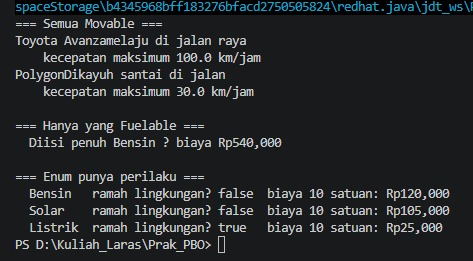
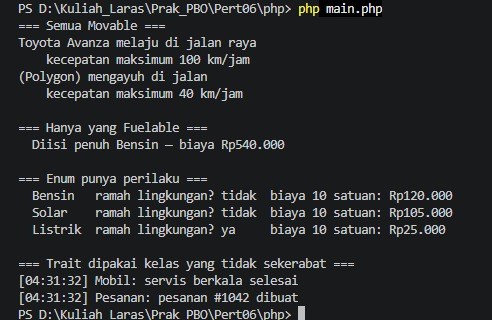

# Analisis Before--After Pertemuan 06 --- Java

## 1. Sumber Perbandingan

-   **Before:** `pertemuan06.rar`, folder
    `06-abstract-class-interface-enum-dan-trait/starter/java/`.
-   **After:** `Pert06.rar`, folder `Pert06/java/`.
-   **Fokus materi:** abstract class, interface, enum, default method,
    polymorphism, dan pemisahan kemampuan objek.

## 2. `Movable.java`

### Before

``` java
default String ringkasanGerak() {
    return "(TODO 1 belum dikerjakan)";
}
```

### After

``` java
default String ringkasanGerak() {
    return "kecepatan maksimum " + kecepatanMaksimum() + " km/jam";
}
```

### Analisis

-   Sebelum perubahan, `ringkasanGerak()` hanya mengembalikan teks
    placeholder.
-   Sesudah perubahan, ringkasan dibentuk dari nilai
    `kecepatanMaksimum()` milik objek.
-   Karena berupa `default method`, kelas yang mengimplementasikan
    `Movable` dapat langsung memakai implementasi ini tanpa wajib
    menulis ulang method tersebut.
-   Ini merupakan contoh perilaku umum yang disediakan oleh interface
    Java.

## 3. `Kendaraan.java`

### Before

``` java
/** TODO 1: kembalikan umur kendaraan, tidak boleh negatif. */
public int umur(int tahunSekarang) {
    return 0;   // ganti
}
```

### After

``` java
public int umur(int tahunSekarang) {
    return Math.max(0, tahunSekarang - tahun);
}
```

### Analisis

Versi awal selalu mengembalikan `0`, berapa pun tahun kendaraan dan
tahun saat ini. Versi baru menghitung selisih `tahunSekarang - tahun`.
`Math.max(0, ...)` memastikan umur tidak menjadi negatif apabila tahun
yang diberikan lebih kecil daripada tahun kendaraan. `Kendaraan` tetap
abstrak dan tetap menyerahkan implementasi `jumlahRoda()` kepada kelas
turunan.

## 4. `TipeBahanBakar.java`

### Before

``` java
BENSIN("Bensin", 0),
SOLAR("Solar", 0);
// TODO: tambahkan LISTRIK.

public double biayaPengisian(double jumlah) {
    return 0;
}

public boolean ramahLingkungan() {
    return false;
}
```

### After

``` java
BENSIN("Bensin", 12000),
SOLAR("Solar", 10500),
LISTRIK("Listrik", 2500);

public double biayaPengisian(double jumlah) {
    return jumlah * hargaPerSatuan;
}

public boolean ramahLingkungan() {
    return this == LISTRIK;
}
```

### Analisis

-   Case `LISTRIK` ditambahkan bersama label dan harga per satuan.
-   Biaya pengisian dihitung dari jumlah dikalikan harga per satuan.
-   Hanya `LISTRIK` yang menghasilkan `true` pada `ramahLingkungan()`.
-   Enum kini menyimpan pilihan yang terbatas sekaligus data dan
    perilaku untuk setiap pilihan, bukan hanya nama konstanta.

## 5. `Mobil.java`

### Before

``` java
@Override public void bergerak() {
    // TODO: cetak pesan mobil bergerak.
}

@Override public double kecepatanMaksimum() {
    return 0;
}

@Override public void isiBahanBakar(double jumlah) {
    // TODO: validasi dan tambah isiTangki.
}
```

### After

``` java
@Override public void bergerak() {
    System.out.println(merek + "melaju di jalan raya");
}

@Override public double kecepatanMaksimum() {
    return 100;
}

@Override public void isiBahanBakar(double jumlah) {
    if (jumlah <= 0) {
        throw new IllegalArgumentException(
            "Jumlah bahan bakar harus lebih dari 0"
        );
    }

    if (isiTangki + jumlah > kapasitasTangki) {
        throw new IllegalArgumentException(
            "Pengisian melebihi kapasitas tangki"
        );
    }

    isiTangki += jumlah;
}
```

### Analisis

-   `bergerak()` sekarang mencetak pesan bahwa mobil melaju di jalan
    raya.
-   Kecepatan maksimum mobil ditetapkan menjadi `100`.
-   `isiBahanBakar()` menolak jumlah nol atau negatif, serta menolak
    pengisian yang membuat isi tangki melewati kapasitas.
-   Jika masukan valid, jumlah bahan bakar ditambahkan ke `isiTangki`.
-   **Catatan perbaikan:** output `bergerak()` saat ini menggabungkan
    merek dan kata "melaju" tanpa spasi. Gunakan
    `merek + " melaju di jalan raya"` agar hasilnya lebih rapi.
-   Konstruktor belum memvalidasi kapasitas tangki; nilai nol atau
    negatif sebaiknya ditolak.

## 6. `Sepeda.java` --- Kelas Baru

### Before

Kelas `Sepeda` belum tersedia. `Main.java` hanya memiliki TODO untuk
menambahkannya.

### After

``` java
public class Sepeda extends Kendaraan implements Movable {
    public Sepeda(String merek, int tahun) {
        super(merek, tahun);
    }

    @Override
    public int jumlahRoda() {
        return 2;
    }

    @Override
    public void bergerak() {
        System.out.println(merek + "Dikayuh santai di jalan");
    }

    @Override
    public double kecepatanMaksimum() {
        return 30;
    }
}
```

### Analisis

-   `Sepeda` mewarisi `Kendaraan` dan mengimplementasikan `Movable`.
-   `Sepeda` **tidak** mengimplementasikan `Fuelable`, karena sepeda
    tidak membutuhkan pengisian bahan bakar.
-   Sepeda memiliki dua roda dan kecepatan maksimum `30`.
-   **Catatan perbaikan:** pesan gerak perlu spasi antara nilai `merek`
    dan kata berikutnya, misalnya `merek + " dikayuh santai di jalan"`.

## 7. `Main.java`

### Before

``` java
Mobil mobil = new Mobil("Toyota Avanza", 2022, 45);

for (Movable m : List.of(mobil)) {
    m.bergerak();
    System.out.println("    " + m.ringkasanGerak());
}
```

### After

``` java
Mobil mobil = new Mobil("Toyota Avanza", 2022, 45);
Sepeda sepeda = new Sepeda("Polygon", 2023);

for (Movable m : List.of(mobil, sepeda)) {
    m.bergerak();
    System.out.println("    " + m.ringkasanGerak());
}
```

### Analisis

-   Objek `Sepeda` ditambahkan ke daftar yang bertipe `Movable`.
-   Perulangan yang sama dapat memanggil `bergerak()` dan
    `ringkasanGerak()` pada mobil maupun sepeda.
-   Ini adalah **polymorphism**: kode menggunakan kontrak `Movable`,
    sedangkan perilaku aktual ditentukan oleh kelas objek.
-   Fungsi `isiPenuh()` tetap menerima parameter bertipe `Fuelable`,
    bukan `Mobil`, sehingga dapat digunakan oleh objek lain yang
    mendukung kontrak tersebut.
-   Baris `isiPenuh(sepeda)` tetap dikomentari. Jika diaktifkan, kode
    Java akan gagal dikompilasi karena `Sepeda` bukan `Fuelable`.
    Penolakan saat kompilasi membantu mencegah pemanggilan operasi yang
    tidak sesuai dengan kemampuan objek.

## 8. `Fuelable.java`

### Before dan After

Kontrak interface tidak berubah secara berarti:

``` java
public interface Fuelable {
    void isiBahanBakar(double jumlah);
    double kapasitasTangki();
    TipeBahanBakar tipeBahanBakar();
}
```

### Analisis

`Fuelable` hanya menyatakan kemampuan yang berhubungan dengan bahan
bakar. Pemisahannya dari `Movable` membuat kelas seperti `Sepeda` dapat
bergerak tanpa diwajibkan menyediakan method pengisian bahan bakar. Ini
mendukung **Interface Segregation Principle**.

## 9. Output


## 10. Ringkasan Before dan After

  -----------------------------------------------------------------------
  Bagian                  Before (`pertemuan06`)  After (`Pert06`)
  ----------------------- ----------------------- -----------------------
  `Movable`               Ringkasan gerak masih   Default method menyusun
                          placeholder             ringkasan kecepatan

  `Kendaraan`             `umur()` selalu         Umur dihitung dan tidak
                          mengembalikan `0`       negatif

  `TipeBahanBakar`        Harga `0`, belum ada    Tiga tipe, harga,
                          Listrik, method belum   biaya, dan status ramah
                          selesai                 lingkungan tersedia

  `Mobil`                 Method gerak,           Method dilengkapi dan
                          kecepatan, dan isi      pengisian divalidasi
                          bahan bakar belum       
                          selesai                 

  `Sepeda`                Belum tersedia          Kelas baru yang
                                                  `Movable`, bukan
                                                  `Fuelable`

  `Main`                  Daftar `Movable` hanya  Mobil dan sepeda
                          berisi mobil            diproses melalui
                                                  interface yang sama

  `Fuelable`              Kontrak sudah           Kontrak tetap
                          disediakan              memisahkan kemampuan
                                                  pengisian bahan bakar
  -----------------------------------------------------------------------

## 11. Kesimpulan

Versi sesudah melengkapi sebagian besar TODO pada kode awal. Perubahan
utama adalah default method pada interface `Movable`, perhitungan umur
kendaraan, enum yang memiliki harga dan perilaku, validasi pengisian
bahan bakar, serta penambahan `Sepeda` untuk menunjukkan polymorphism
dan pemisahan interface. Perbaikan lanjutan yang disarankan adalah
menambahkan spasi pada pesan gerak dan memvalidasi kapasitas tangki saat
objek `Mobil` dibuat.

# Analisis Before--After Pertemuan 06 --- PHP

## 1. Sumber Perbandingan

-   **Before:** `pertemuan06.rar`, folder
    `06-abstract-class-interface-enum-dan-trait/starter/php/`.
-   **After:** `Pert06.rar`, folder `Pert06/php/`.
-   **Fokus materi:** abstract class, interface, backed enum, trait,
    validasi, dan polymorphism.

## 2. Enum `TipeBahanBakar`

### Before

``` php
enum TipeBahanBakar: string
{
    case Bensin = 'bensin';
    case Solar  = 'solar';

    public function label(): string
    {
        return '?';
    }

    public function hargaPerSatuan(): float
    {
        return 0;
    }

    public function biayaPengisian(float $jumlah): float
    {
        return 0;
    }

    public function ramahLingkungan(): bool
    {
        return false;
    }
}
```

### After

``` php
enum TipeBahanBakar: string
{
    case Bensin  = 'bensin';
    case Solar   = 'solar';
    case Listrik = 'listrik';

    public function label(): string
    {
        return match ($this) {
            self::Bensin  => 'Bensin',
            self::Solar   => 'Solar',
            self::Listrik => 'Listrik',
        };
    }

    public function hargaPerSatuan(): float
    {
        return match ($this) {
            self::Bensin  => 12000,
            self::Solar   => 10500,
            self::Listrik => 2500,
        };
    }

    public function biayaPengisian(float $jumlah): float
    {
        return $jumlah * $this->hargaPerSatuan();
    }

    public function ramahLingkungan(): bool
    {
        return $this === self::Listrik;
    }
}
```

### Analisis

-   Case `Listrik` ditambahkan.
-   `label()` dan `hargaPerSatuan()` menggunakan `match` untuk
    menentukan hasil berdasarkan case enum.
-   `biayaPengisian()` menghitung jumlah dikalikan harga per satuan.
-   `ramahLingkungan()` hanya menghasilkan `true` untuk `Listrik`.
-   Enum sekarang menyediakan data dan perilaku terkait setiap tipe
    bahan bakar.

## 3. Trait `Loggable`

### Before

``` php
trait Loggable
{
    public function log(string $pesan): void
    {
        // TODO 6
    }
}
```

### After

``` php
trait Loggable
{
    public function log(string $pesan): void
    {
        printf("[%s] %s: %s\n", date('H:i:s'), static::class, $pesan);
    }
}
```

### Analisis

-   Sebelum perubahan, method `log()` belum melakukan apa pun.
-   Sesudah perubahan, method mencetak waktu, nama kelas yang
    menggunakan trait, dan isi pesan.
-   `static::class` memungkinkan nama kelas pemakai trait muncul dalam
    log, misalnya `Mobil` atau `Pesanan`.
-   Trait dapat dipakai ulang oleh kelas-kelas yang tidak memiliki
    hubungan pewarisan.

## 4. Abstract Class `Kendaraan`

### Before

``` php
/** TODO 7: umur kendaraan, tidak boleh negatif. */
public function umur(int $tahunSekarang): int
{
    return 0;
}
```

### After

``` php
public function umur(int $tahunSekarang): int
{
    return max(0, $tahunSekarang - $this->tahun);
}
```

### Analisis

Versi awal selalu mengembalikan `0`. Versi baru menghitung umur dari
selisih tahun dan menggunakan `max(0, ...)` agar hasil tidak negatif.
`Kendaraan` tetap menjadi abstract class yang menyimpan data umum,
sedangkan method abstrak `jumlahRoda()` harus diimplementasikan oleh
kelas turunannya.

## 5. Kelas `Mobil`

### Before

``` php
// TODO: lengkapi kontrak Movable dan Fuelable.
public function bergerak(): void {}
public function kecepatanMaksimum(): float { return 0; }
public function isiBahanBakar(float $jumlah): void {}
```

### After

``` php
public function bergerak(): void
{
    echo "{$this->merek} melaju di jalan raya\n";
}

public function kecepatanMaksimum(): float
{
    return 100;
}

public function isiBahanBakar(float $jumlah): void
{
    if ($jumlah <= 0) {
        throw new InvalidArgumentException(
            'Jumlah bahan bakar harus lebih dari 0'
        );
    }

    if ($this->isiTangki + $jumlah > $this->kapasitas) {
        throw new InvalidArgumentException(
            'Pengisian melebihi kapasitas tangki'
        );
    }

    $this->isiTangki += $jumlah;
}
```

### Analisis

-   `bergerak()` mencetak pesan mobil melaju di jalan raya.
-   Kecepatan maksimum mobil ditetapkan menjadi `100`.
-   Pengisian bahan bakar menolak jumlah yang tidak positif dan jumlah
    yang membuat isi tangki melebihi kapasitas.
-   Jumlah baru ditambahkan setelah lolos validasi.
-   **Catatan perbaikan:** konstruktor belum memvalidasi kapasitas
    tangki, sehingga sebaiknya kapasitas nol atau negatif ditolak sejak
    awal.

## 6. Kelas `Sepeda` --- Kelas Baru

### Before

Kelas `Sepeda` belum tersedia; hanya terdapat TODO yang meminta kelas
tersebut dibuat dengan `Kendaraan` dan `Movable`, tetapi bukan
`Fuelable`.

### After

``` php
final class Sepeda extends Kendaraan implements Movable
{
    public function jumlahRoda(): int
    {
        return 2;
    }

    public function bergerak(): void
    {
        echo "({$this->merek}) mengayuh di jalan\n";
    }

    public function kecepatanMaksimum(): float
    {
        return 40;
    }
}
```

### Analisis

-   `Sepeda` mewarisi `Kendaraan` dan mengimplementasikan `Movable`.
-   Kelas ini tidak mengimplementasikan `Fuelable`, karena sepeda tidak
    memerlukan pengisian bahan bakar.
-   Method `jumlahRoda()` mengembalikan `2`, dan kecepatan maksimum
    ditetapkan menjadi `40`.
-   Deklarasi tipe PHP pada fungsi yang meminta `Fuelable` akan menolak
    objek `Sepeda` saat fungsi dipanggil.

## 7. Kelas `Pesanan` --- Kelas Baru

### Before

Kelas `Pesanan` belum tersedia. Komentar TODO meminta kelas yang memakai
`Loggable`, tetapi tidak mewarisi `Kendaraan`.

### After

``` php
final class Pesanan
{
    use Loggable;
}
```

### Analisis

`Pesanan` menggunakan trait `Loggable` tanpa menjadi turunan
`Kendaraan`. Ini menunjukkan bahwa trait memungkinkan penggunaan ulang
method pada kelas yang tidak sekerabat melalui inheritance.

## 8. `main.php`

### Before

``` php
$mobil = new Mobil('Toyota Avanza', 2022, 45);

foreach ([$mobil] as $m) {
    $m->bergerak();
    printf(
        '    kecepatan maksimum %.0f km/jam%s',
        $m->kecepatanMaksimum(),
        PHP_EOL
    );
}

$mobil->log('servis berkala selesai');
// TODO: (new Pesanan())->log('pesanan #1042 dibuat');
```

### After

``` php
$mobil = new Mobil('Toyota Avanza', 2022, 45);
$sepeda = new Sepeda('Polygon', 2023);

foreach ([$mobil, $sepeda] as $m) {
    $m->bergerak();
    printf(
        '    kecepatan maksimum %.0f km/jam%s',
        $m->kecepatanMaksimum(),
        PHP_EOL
    );
}

$mobil->log('servis berkala selesai');
(new Pesanan())->log('pesanan #1042 dibuat');
```

### Analisis

-   Objek `Sepeda` ditambahkan ke daftar bersama `Mobil`.
-   Keduanya diproses melalui method yang sama, yaitu `bergerak()` dan
    `kecepatanMaksimum()`, yang menunjukkan **polymorphism** melalui
    interface `Movable`.
-   Log dijalankan pada `Mobil` dan `Pesanan`, sehingga penggunaan ulang
    trait terlihat pada dua kelas yang berbeda.
-   `isiPenuh()` tetap menggunakan type hint `Fuelable`. Baris
    `isiPenuh($sepeda)` tetap dikomentari; jika dijalankan, PHP akan
    menghasilkan `TypeError` karena `Sepeda` tidak mengimplementasikan
    `Fuelable`.

## 9. Interface `Movable` dan `Fuelable`

### Before dan After

Kontrak kedua interface tetap sama:

``` php
interface Movable
{
    public function bergerak(): void;
    public function kecepatanMaksimum(): float;
}

interface Fuelable
{
    public function isiBahanBakar(float $jumlah): void;
    public function kapasitasTangki(): float;
    public function tipeBahanBakar(): TipeBahanBakar;
}
```

### Analisis

`Movable` menyatakan kemampuan bergerak, sedangkan `Fuelable` menyatakan
kemampuan terkait bahan bakar. Pemisahan kontrak ini mencegah kelas yang
tidak membutuhkan bahan bakar, seperti `Sepeda`, diwajibkan
mengimplementasikan method yang tidak relevan.

## 10. Output


## 11. Ringkasan Before dan After

  -----------------------------------------------------------------------
  Bagian                  Before (`pertemuan06`)  After (`Pert06`)
  ----------------------- ----------------------- -----------------------
  `TipeBahanBakar`        Hanya Bensin dan Solar; Menambahkan Listrik,
                          method masih            label, harga, biaya,
                          placeholder             dan status ramah
                                                  lingkungan

  `Loggable`              Method `log()` kosong   Mencetak waktu, kelas,
                                                  dan pesan

  `Kendaraan`             `umur()` selalu `0`     Umur dihitung dan tidak
                                                  negatif

  `Mobil`                 Method gerak,           Method dilengkapi dan
                          kecepatan, dan          pengisian divalidasi
                          pengisian belum selesai 

  `Sepeda`                Belum tersedia          Kelas baru yang
                                                  `Movable`, bukan
                                                  `Fuelable`

  `Pesanan`               Belum tersedia          Kelas baru yang
                                                  menggunakan trait
                                                  `Loggable`

  `main.php`              Hanya menguji Mobil;    Mobil dan Sepeda
                          log Pesanan TODO        diproses bersama; log
                                                  Pesanan dijalankan
  -----------------------------------------------------------------------

## 12. Kesimpulan

Versi sesudah melengkapi bagian utama latihan dengan enum yang memiliki
perilaku, trait `Loggable`, perhitungan umur kendaraan, validasi
pengisian bahan bakar, serta penambahan `Sepeda` dan `Pesanan`. Program
memperlihatkan perbedaan fungsi abstract class, interface, enum, dan
trait, serta bagaimana polymorphism membuat beberapa objek dapat
diproses melalui kontrak yang sama.

