# Pert07 — Analisis Before vs After: Komposisi & Agregasi (Sistem Perpustakaan)

Dokumen ini membandingkan kode **sebelum** (`starter`, berisi kerangka dengan `TODO`) dan
**sesudah** (`Pert07`, hasil pengerjaan) pada topik **komposisi** dan **agregasi** di dua bahasa:
**Java** dan **PHP**. Setiap kelas dibahas dengan tangkapan layar *before* dan *after*,
perubahan yang dilakukan, konsep OOP di baliknya, serta catatan temuan.

---

## Daftar Isi

1. [Struktur Proyek](#1-struktur-proyek)
2. [Ringkasan Perubahan](#2-ringkasan-perubahan)
3. [Konsep Singkat: Komposisi vs Agregasi](#3-konsep-singkat-komposisi-vs-agregasi)
4. [Analisis Java](#4-analisis-java)
   - [4.1 `Buku` dan `Buku.Bab` (Komposisi)](#41-buku-dan-bukubab-komposisi)
   - [4.2 `Jurusan` dan `Jurusan.Mahasiswa` (Agregasi)](#42-jurusan-dan-jurusanmahasiswa-agregasi)
   - [4.3 `PerpustakaanService`](#43-perpustakaanservice)
   - [4.4 `Main`](#44-main)
5. [Analisis PHP](#5-analisis-php)
   - [5.1 `Bab`](#51-bab)
   - [5.2 `Buku`](#52-buku)
   - [5.3 `Mahasiswa`](#53-mahasiswa)
   - [5.4 `Jurusan`](#54-jurusan)
   - [5.5 Enum `JenisKeanggotaan` dan `StatusKoleksi`](#55-enum-jeniskeanggotaan-dan-statuskoleksi)
   - [5.6 `main.php`](#56-mainphp)
6. [Perbandingan Java vs PHP](#6-perbandingan-java-vs-php)
7. [Temuan dan Rekomendasi Perbaikan](#7-temuan-dan-rekomendasi-perbaikan)
8. [Kesimpulan](#8-kesimpulan)

---

## 1. Struktur Proyek

```
Pert07/
├── README.md
├── images/
│   ├── before/        # 9 tangkapan layar kode awal
│   └── after/         # 12 tangkapan layar kode akhir
├── java/
│   ├── Main.java
│   ├── model/
│   │   ├── Buku.java        # komposisi (Buku → Bab)
│   │   └── Jurusan.java     # agregasi  (Jurusan → Mahasiswa)
│   └── service/
│       └── PerpustakaanService.java
└── php/
    ├── main.php
    └── relasi.php           # Bab, Buku, Mahasiswa, Jurusan, 2 enum
```

> Berkas `deskripsi-kebutuhan.md` dan `uml/perpustakaan-kerangka.puml` hanya ada di `starter`
> dan tidak ikut di `Pert07`, sehingga class diagram belum dibandingkan di sini.

---

## 2. Ringkasan Perubahan

| Berkas | Baris dihapus | Baris ditambah | Total baris (before → after) | Inti perubahan |
|---|---:|---:|:---:|---|
| `java/model/Buku.java` | 2 | 11 | 86 → 94 | Validasi eksemplar, `tambahBab`, `getBab` salinan, `kurangiStok` |
| `java/model/Jurusan.java` | 2 | 12 | 61 → 70 | `daftarkan`, `keluarkan`, `getMahasiswa` salinan |
| `java/service/PerpustakaanService.java` | 1 | 21 | 36 → 55 | Penyimpanan koleksi + 4 method layanan |
| `java/Main.java` | 1 | 1 | 48 → 47 | **Tidak ada perubahan logika** (hanya baris akhir berkas) |
| `php/relasi.php` | 23 | 126 | 105 → 207 | Constructor `Bab`, validasi, 2 enum, `daftarkan`/`keluarkan`, dll. |
| `php/main.php` | 1 | 1 | 27 → 26 | **Tidak ada perubahan logika** (hanya baris akhir berkas) |

Kolom baris dihitung setelah mengabaikan perbedaan karakter akhir baris (CRLF/LF).

---

## 3. Konsep Singkat: Komposisi vs Agregasi

| Aspek | Komposisi (`Buku` ◆— `Bab`) | Agregasi (`Jurusan` ◇— `Mahasiswa`) |
|---|---|---|
| Siklus hidup bagian | Terikat induk; tidak bermakna tanpa `Buku` | Mandiri; tetap hidup tanpa `Jurusan` |
| Asal objek bagian | **Dibuat di dalam** induk (`new Bab(...)` dalam `Buku`) | **Datang dari luar** (diterima lewat parameter) |
| Bentuk method penambah | `tambahBab(int nomor, String judul)` — menerima *data* | `daftarkan(Mahasiswa m)` — menerima *objek* |
| Constructor bagian | `private` (hanya `Buku` yang boleh membuat) | `public` (siapa pun boleh membuat) |
| Getter koleksi | Salinan tak-berubah (`List.copyOf`) | Salinan tak-berubah (`List.copyOf`) |

Tiga syarat komposisi yang diminta kerangka kode: (1) tidak menerima objek bagian dari luar,
(2) objek bagian dibuat di dalam induk, (3) getter mengembalikan salinan yang tidak bisa diubah.

---

## 4. Analisis Java

### 4.1 `Buku` dan `Buku.Bab` (Komposisi)

**File:** `java/model/Buku.java` — 4 TODO dikerjakan.

#### Constructor — validasi eksemplar (TODO 1) dan `tambahBab` / `getBab` (TODO 2 & 3)

| Before | After |
|:---:|:---:|
| 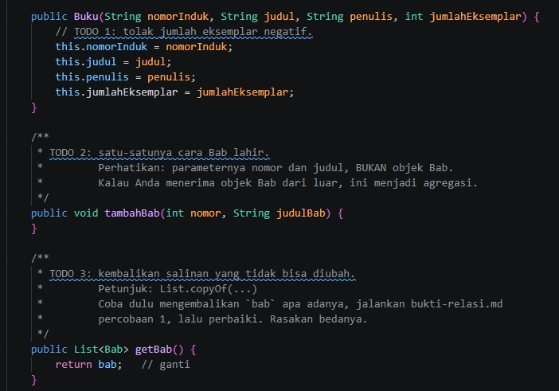 | 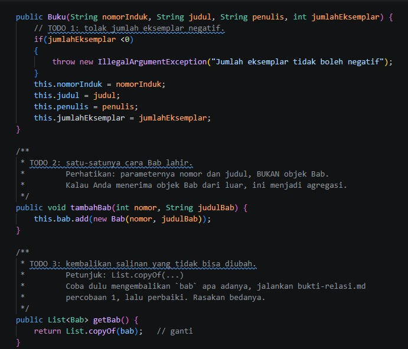 |

**Perubahan**

| Bagian | Before | After |
|---|---|---|
| Constructor | Hanya menyalin parameter | Melempar `IllegalArgumentException` bila `jumlahEksemplar < 0` |
| `tambahBab(int, String)` | Badan kosong | `this.bab.add(new Bab(nomor, judulBab))` |
| `getBab()` | `return bab;` (list internal bocor) | `return List.copyOf(bab);` |

**Analisis**

- **Validasi di constructor** menjaga invariant bahwa objek tidak pernah lahir dalam keadaan tidak valid
  (stok negatif). Pemeriksaan dilakukan *sebelum* field diisi, sehingga tidak ada objek setengah jadi.
- **`tambahBab` menerima `nomor` dan `judul`, bukan objek `Bab`.** Inilah yang membuat relasi
  benar-benar *komposisi*: `Bab` dibuat di dalam `Buku`, dan constructor `Bab` bersifat `private`,
  sehingga kode luar tidak mungkin membuat `Bab` lalu menyuntikkannya.
- **`List.copyOf(bab)`** mengembalikan salinan *immutable*. Sebelumnya, `buku.getBab().clear()` dari
  `Main` akan **berhasil** mengosongkan list internal (enkapsulasi bocor). Sekarang pemanggilan itu
  melempar `UnsupportedOperationException`, yang ditangkap `Main` dan dicetak sebagai
  "Ditolak — koleksi bab tidak bisa diubah dari luar. Benar."

#### Stok: `kurangiStok` (TODO 4)

| Before | After |
|:---:|:---:|
| 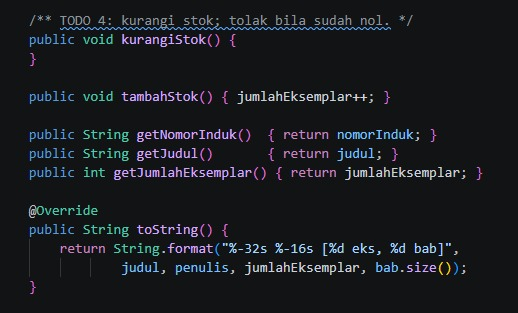 | 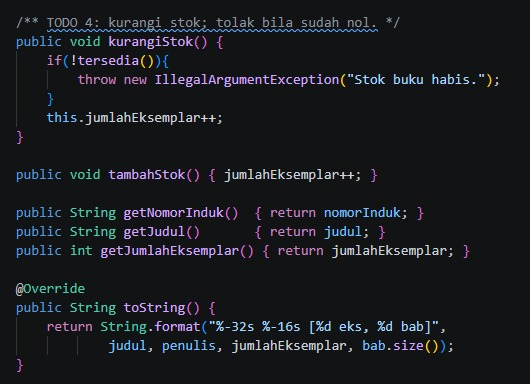 |

**Perubahan**

```java
// Before
public void kurangiStok() { }

// After
public void kurangiStok() {
    if(!tersedia()){
        throw new IllegalArgumentException("Stok buku habis.");
    }
    this.jumlahEksemplar++;   // <-- lihat catatan di bawah
}
```

**Analisis**

- Guard `if(!tersedia())` sudah benar: peminjaman ditolak saat stok nol, sesuai aturan
  *"Koleksi hanya dapat dipinjam bila masih ada eksemplar tersedia"*.
- ⚠️ **Bug logika:** badan method memakai `jumlahEksemplar++` padahal seharusnya `--`.
  Akibatnya setiap peminjaman justru **menambah** stok. Perbaikannya ada di
  [bagian 7](#7-temuan-dan-rekomendasi-perbaikan).
- Pengecualian yang dipilih (`IllegalArgumentException`) kurang tepat secara semantik: argumennya
  tidak salah, yang salah adalah *keadaan* objek. `IllegalStateException` lebih sesuai.

#### Nested class `Bab` (tidak berubah)

Kelas `Buku.Bab` sudah lengkap sejak *starter*: `public static final class` dengan constructor
`private` dan field `final`. Ini mekanisme Java yang menegakkan komposisi di level bahasa.

---

### 4.2 `Jurusan` dan `Jurusan.Mahasiswa` (Agregasi)

**File:** `java/model/Jurusan.java` — 3 TODO dikerjakan.

| Before | After |
|:---:|:---:|
| 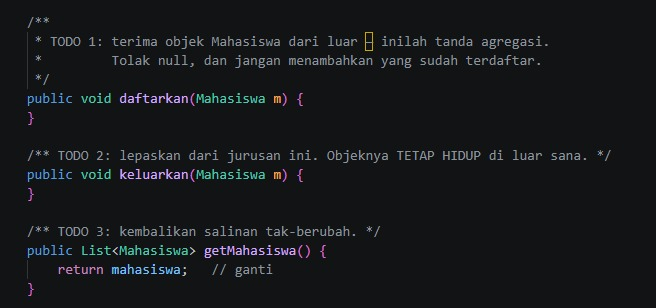 | 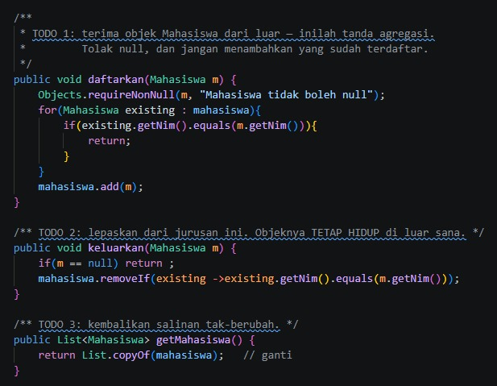 |

**Perubahan**

| Method | Before | After |
|---|---|---|
| `daftarkan(Mahasiswa m)` | Kosong | `Objects.requireNonNull(m, ...)`, lalu tambahkan hanya bila NIM belum terdaftar |
| `keluarkan(Mahasiswa m)` | Kosong | Abaikan `null`; hapus dengan `removeIf` berdasarkan NIM |
| `getMahasiswa()` | `return mahasiswa;` | `return List.copyOf(mahasiswa);` |

**Analisis**

- **`daftarkan` menerima objek `Mahasiswa` dari luar** — ciri khas agregasi. Constructor
  `Mahasiswa` bersifat `public`, jadi objek bisa dibuat dan hidup sebelum maupun sesudah terdaftar.
- **Penolakan `null`** memakai `Objects.requireNonNull` (gagal cepat dengan pesan jelas).
  Pencegahan duplikat dilakukan dengan membandingkan **NIM**, bukan referensi objek, sehingga dua
  objek berbeda dengan NIM sama tidak masuk dua kali.
- **`keluarkan` hanya melepas referensi** dari list; objek `Mahasiswa` tetap hidup. Di `Main`,
  `budi` masih bisa dicetak setelah dikeluarkan dari `informatika` — inilah pembuktian bedanya dengan
  komposisi.
- **Sikap tidak konsisten terhadap `null`:** `daftarkan` melempar `NullPointerException`,
  sedangkan `keluarkan` diam-diam mengabaikannya. Keduanya sah, tetapi sebaiknya satu kebijakan.
- `getMahasiswa()` kini mengembalikan salinan *immutable*, sehingga enkapsulasi list terjaga.

---

### 4.3 `PerpustakaanService`

**File:** `java/service/PerpustakaanService.java` — 5 TODO dikerjakan.

| Before | After |
|:---:|:---:|
| 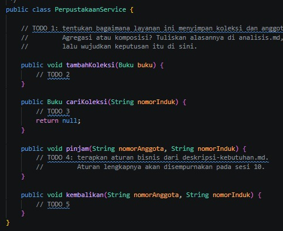 | 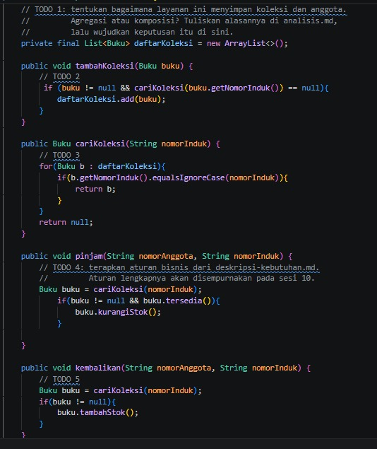 |

**Perubahan**

| Method | Before | After |
|---|---|---|
| Penyimpanan (TODO 1) | Tidak ada | `private final List<Buku> daftarKoleksi = new ArrayList<>();` |
| `tambahKoleksi` | Kosong | Tambah bila `buku != null` dan nomor induk belum ada |
| `cariKoleksi` | `return null;` | Telusuri list, cocokkan `nomorInduk` dengan `equalsIgnoreCase` |
| `pinjam` | Kosong | Cari buku; bila ada dan tersedia → `kurangiStok()` |
| `kembalikan` | Kosong | Cari buku; bila ada → `tambahStok()` |

**Analisis**

- **Relasi `PerpustakaanService` → `Buku` adalah agregasi:** `Buku` dibuat di luar lalu diserahkan lewat
  `tambahKoleksi(Buku)`. Layanan hanya menyimpan referensi, bukan memiliki siklus hidup buku.
  (Catatan: alasan agregasi vs komposisi sebaiknya ditulis di `analisis.md` sesuai TODO 1.)
- Memakai `List` dan pencarian linear sudah cukup untuk sesi 7. `Map<String, Buku>` akan membuat
  `cariKoleksi` O(1) dan pengecekan duplikat lebih ringkas.
- **Keterbatasan yang perlu dicatat:**
  - `nomorAnggota` pada `pinjam` dan `kembalikan` belum dipakai (belum ada kelas `Anggota`/`Peminjaman`).
  - Kegagalan `pinjam` (buku tidak ada / stok habis) **senyap** — pemanggil tidak tahu peminjaman gagal.
    Pada sesi 10 (exception) ini sebaiknya diganti pengecualian bisnis.
  - `kembalikan` tidak membatasi stok, sehingga bisa melebihi jumlah awal bila dipanggil berulang.
  - Hanya `Buku` yang didukung, belum `Koleksi` abstrak (`Majalah`, `Skripsi`).

---

### 4.4 `Main`

Isi `Main.java` **identik secara logika** antara *before* dan *after* (selisih hanya ada/tidaknya baris
baru di akhir berkas). `Main` berperan sebagai *driver* pembuktian: ia memanggil `tambahBab`,
mencoba `getBab().clear()`, lalu mendemonstrasikan bahwa `Mahasiswa` tetap hidup setelah
dikeluarkan dari `Jurusan`. Karena kerangka `Buku` dan `Jurusan` sebelumnya kosong, `Main` baru
memberi keluaran bermakna setelah TODO dikerjakan.

---

## 5. Analisis PHP

PHP tidak mengenal *nested class*, sehingga seluruh kelas berada di satu berkas `relasi.php`.

### 5.1 `Bab`

**File:** `php/relasi.php` — TODO 1.

| Before | After |
|:---:|:---:|
| 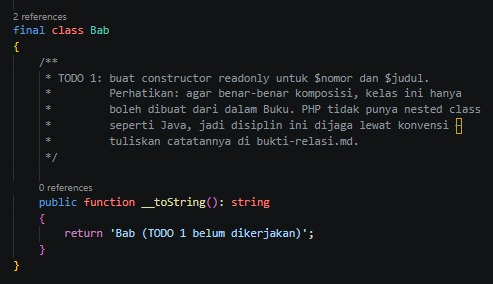 | 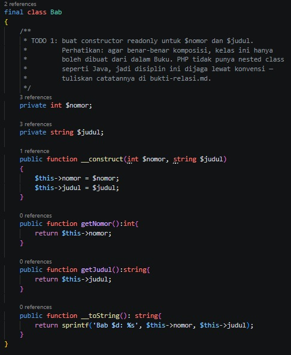 |

**Perubahan**

| Bagian | Before | After |
|---|---|---|
| Properti | Tidak ada | `private int $nomor;` `private string $judul;` |
| Constructor | Tidak ada | `__construct(int $nomor, string $judul)` |
| Getter | Tidak ada | `getNomor()` dan `getJudul()` |
| `__toString()` | `'Bab (TODO 1 belum dikerjakan)'` | `sprintf('Bab $d: %s', $this->nomor, $this->judul)` |

**Analisis**

- Kelas kini berfungsi sebagai objek nilai (*value object*) yang hanya dapat dibaca: tidak ada setter,
  sehingga setelah dibuat tidak bisa diubah. Ini penting karena `Buku::getBab()` membagikan referensi
  objek `Bab` yang sama.
- Kerangka menyarankan constructor *readonly*; hasil akhir memakai properti `private` biasa tanpa
  setter. Secara efek mirip, tetapi `private readonly` memberi jaminan tingkat bahasa
  (PHP 8.1+) dan lebih ringkas dengan *constructor promotion*.
- PHP tidak bisa membatasi siapa yang memanggil `new Bab(...)` (constructor `public`). Disiplin
  komposisi di PHP bergantung pada **konvensi**: hanya `Buku::tambahBab` yang boleh membuat `Bab`.
  Konvensi ini perlu didokumentasikan di `bukti-relasi.md`.
- ⚠️ **Bug format:** `'Bab $d: %s'` memakai tanda kutip tunggal dan `$d` (bukan `%d`). Hasilnya
  `Bab $d: 1`, dan judul tidak tercetak. Perbaikan: `'Bab %d: %s'`.

---

### 5.2 `Buku`

**File:** `php/relasi.php` — TODO 2, 3, 4.

#### Properti dan constructor

| Before | After |
|:---:|:---:|
| 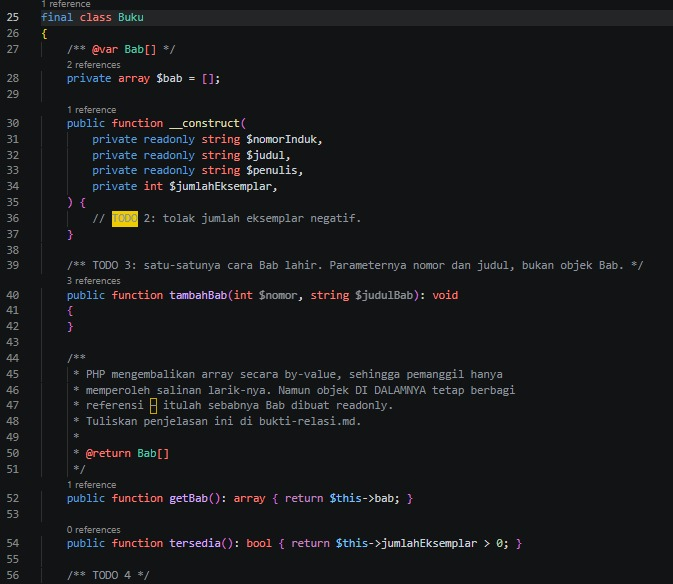 | 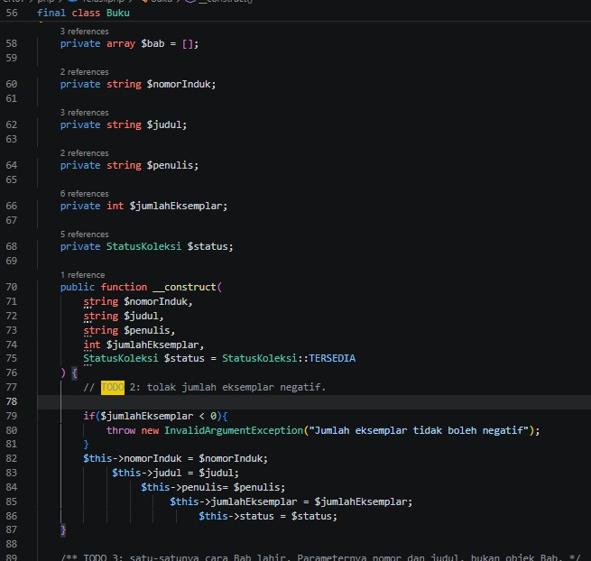 |

**Perubahan**

| Bagian | Before | After |
|---|---|---|
| Deklarasi properti | *Constructor promotion* (`private readonly string $nomorInduk, ...`) | Properti dideklarasikan eksplisit satu per satu |
| Parameter constructor | 4 parameter | 5 parameter: tambah `StatusKoleksi $status = StatusKoleksi::TERSEDIA` |
| Validasi | Hanya komentar TODO | `throw new InvalidArgumentException(...)` bila `< 0` |

**Analisis**

- Validasi stok negatif kini ada, setara dengan versi Java.
- Properti baru `$status` bertipe enum `StatusKoleksi` dengan nilai awal `TERSEDIA` — wujud dari
  aturan *"koleksi dapat berstatus tersedia, dipinjam, rusak, atau hilang"*.
- Pergeseran dari *constructor promotion + `readonly`* ke properti biasa membuat kode lebih panjang
  dan **melepas jaminan imutabilitas** pada `$nomorInduk`, `$judul`, `$penulis`. Padahal nomor induk
  tidak seharusnya berubah. Sebaiknya tetap `private readonly`.
- Indentasi pengisian properti bertingkat (menjorok makin dalam) mengurangi keterbacaan dan
  sebaiknya diratakan.

#### `tambahBab`, `getBab`, dan stok

| Before | After |
|:---:|:---:|
| 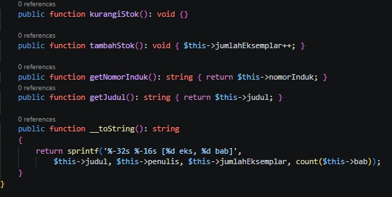 | 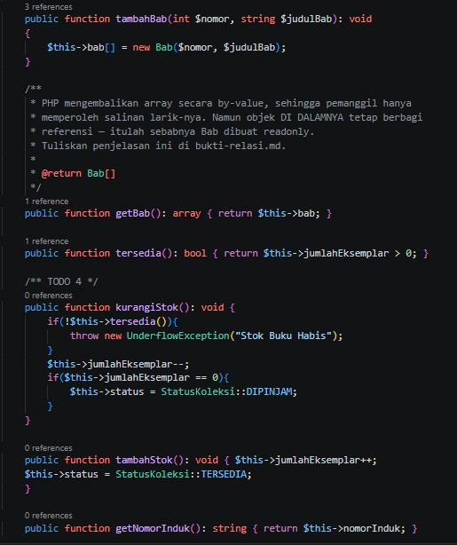 |

**Perubahan**

```php
// Before
public function tambahBab(int $nomor, string $judulBab): void {}
public function kurangiStok(): void {}
public function tambahStok(): void { $this->jumlahEksemplar++; }

// After
public function tambahBab(int $nomor, string $judulBab): void
{
    $this->bab[] = new Bab($nomor, $judulBab);
}
public function kurangiStok(): void {
    if(!$this->tersedia()){
        throw new UnderflowException("Stok Buku Habis");
    }
    $this->jumlahEksemplar--;
    if($this->jumlahEksemplar == 0){
        $this->status = StatusKoleksi::DIPINJAM;
    }
}
public function tambahStok(): void {
    $this->jumlahEksemplar++;
    $this->status = StatusKoleksi::TERSEDIA;
}
```

**Analisis**

- **`tambahBab` membuat `Bab` di dalam `Buku`** (`new Bab(...)`) dan menerima data, bukan objek —
  komposisi terpenuhi.
- **`getBab()` mengembalikan `array`**. Array di PHP diteruskan *by value*, sehingga pemanggil hanya
  menerima salinan larik; ia tidak bisa menghapus bab dari `Buku`. Namun objek `Bab` di dalamnya
  tetap berbagi referensi — aman karena `Bab` tidak punya setter.
- **`kurangiStok`** benar secara logika: menolak saat habis, mengurangi dengan `--`, dan mengubah
  status menjadi `DIPINJAM` ketika stok mencapai nol. Perhatikan bahwa versi PHP **benar**, sedangkan
  versi Java memakai `++` (lihat 4.1).
- `UnderflowException` cukup deskriptif, tetapi `LogicException`/`DomainException` lebih lazim
  untuk pelanggaran aturan bisnis.
- **`tambahStok` selalu mengembalikan status ke `TERSEDIA`**, termasuk bila buku berstatus `HILANG`
  atau `RUSAK`. Sebaiknya status hanya dipulihkan bila sebelumnya `DIPINJAM`.

#### Getter status dan `__toString`

| Before | After |
|:---:|:---:|
| *(tidak ada — `getStatus()` belum ada)* | 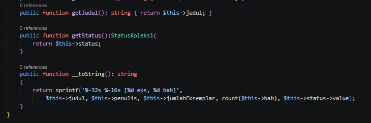 |

**Analisis**

- `getStatus()` menambah akses baca terhadap status koleksi.
- ⚠️ `__toString()` kini meneruskan argumen kelima (`$this->status->value`) ke `sprintf`, tetapi format
  string hanya punya empat placeholder, jadi **status tidak pernah tercetak**. Tambahkan `[%s]` pada
  format bila ingin menampilkannya.

---

### 5.3 `Mahasiswa`

| Before | After |
|:---:|:---:|
| 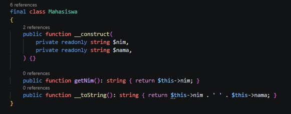 | 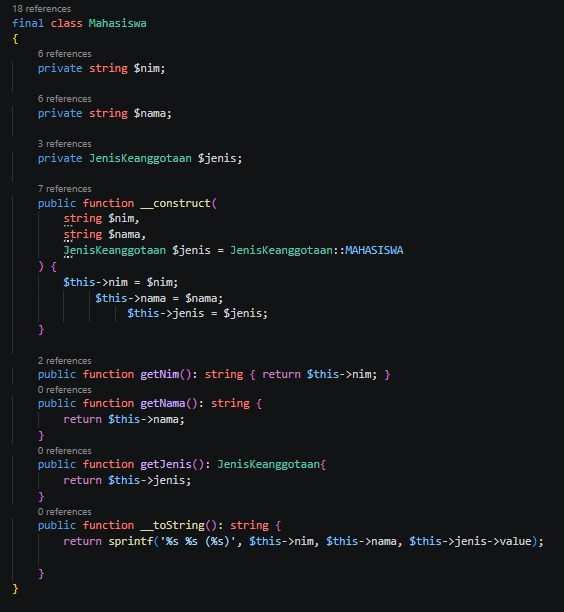 |

**Perubahan**

| Bagian | Before | After |
|---|---|---|
| Constructor | `nim`, `nama` (promotion, `readonly`) | `nim`, `nama`, `JenisKeanggotaan $jenis = MAHASISWA` |
| Getter | `getNim()` | `getNim()`, `getNama()`, `getJenis()` |
| `__toString()` | `nim . ' ' . nama` | `sprintf('%s %s (%s)', nim, nama, jenis->value)` |

**Analisis**

- Menambahkan `jenis` keanggotaan menjawab aturan denda per jenis (mahasiswa, dosen, kehormatan) yang
  tertulis di deskripsi kebutuhan, dan menyiapkan dasar polimorfisme di sesi berikutnya.
- Nilai *default* `MAHASISWA` menjaga kompatibilitas: `new Mahasiswa('2024001', 'Ani Lestari')` di
  `main.php` tetap berjalan tanpa perubahan.
- Seperti `Buku`, properti `$nim` kini tidak `readonly` lagi, padahal deskripsi kebutuhan menyatakan
  *"Nomor anggota tidak pernah berubah setelah didaftarkan"*. Ini regresi kecil terhadap invariant.
- Kelas bernama `Mahasiswa` tetapi mengemban `JenisKeanggotaan` (termasuk `DOSEN`) — nama kelas
  `Anggota` akan lebih tepat pada pengembangan berikutnya.

---

### 5.4 `Jurusan`

| Before | After |
|:---:|:---:|
| 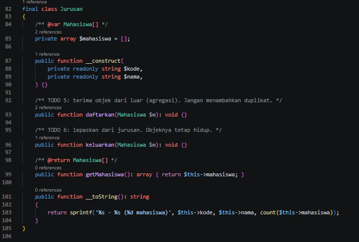 | 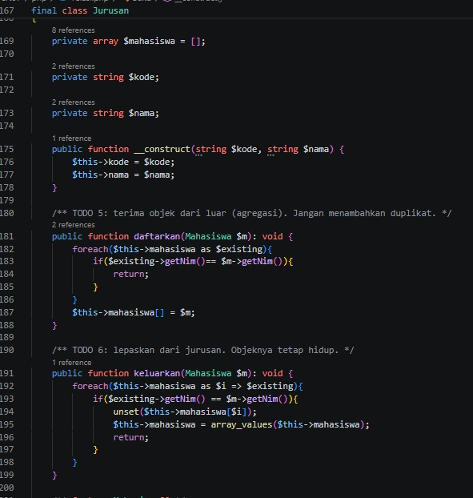 |

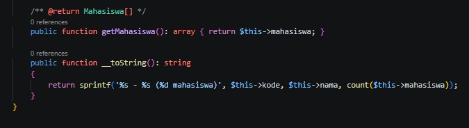

**Perubahan**

| Method | Before | After |
|---|---|---|
| Properti | Constructor promotion `readonly` | Properti eksplisit `$kode`, `$nama` |
| `daftarkan(Mahasiswa $m)` | `{}` | Lewati bila NIM sudah ada, selain itu `$this->mahasiswa[] = $m` |
| `keluarkan(Mahasiswa $m)` | `{}` | Cari berdasarkan NIM, `unset`, lalu `array_values` untuk merapikan indeks |
| `getMahasiswa()` | `return $this->mahasiswa;` | Tidak berubah (array *by value* sudah berupa salinan) |

**Analisis**

- **Agregasi terpenuhi:** `daftarkan` menerima objek `Mahasiswa` yang dibuat di luar, dan
  `keluarkan` hanya melepas referensi sehingga `$budi` tetap hidup (dibuktikan baris terakhir `main.php`).
- Pemanggilan `array_values` setelah `unset` penting agar indeks array tetap berurutan dan
  `count()` serta iterasi tidak terganggu "lubang" indeks.
- Berbeda dengan Java, `getMahasiswa()` tidak perlu diubah: array PHP yang dikembalikan sudah salinan.
  Namun objek `Mahasiswa` di dalamnya tetap dibagi — wajar untuk agregasi, karena memang objek
  tersebut milik pihak luar.
- Tidak ada penolakan `null`; tidak diperlukan karena tipe parameter `Mahasiswa` (non-nullable)
  sudah menolaknya dengan `TypeError`.

---

### 5.5 Enum `JenisKeanggotaan` dan `StatusKoleksi`

| Before | After |
|:---:|:---:|
| *(tidak ada)* | 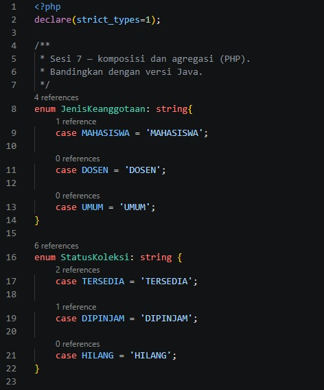 |

**Perubahan:** dua *backed enum* baru ditambahkan di bagian atas `relasi.php`.

```php
enum JenisKeanggotaan: string { case MAHASISWA; case DOSEN; case UMUM; }
enum StatusKoleksi:    string { case TERSEDIA;  case DIPINJAM; case HILANG; }
```

**Analisis**

- Enum menggantikan *string/angka ajaib*: nilai tidak sah mustahil dibuat, dan IDE bisa melengkapi
  otomatis. Ini keputusan desain yang baik.
- ⚠️ **Tidak sesuai deskripsi kebutuhan:**

  | Enum | Di kode | Seharusnya (deskripsi kebutuhan) |
  |---|---|---|
  | `JenisKeanggotaan` | `MAHASISWA`, `DOSEN`, `UMUM` | `MAHASISWA`, `DOSEN`, **`KEHORMATAN`** |
  | `StatusKoleksi` | `TERSEDIA`, `DIPINJAM`, `HILANG` | `TERSEDIA`, `DIPINJAM`, **`RUSAK`**, `HILANG` |

  `UMUM` tidak disebut dalam deskripsi, sedangkan `KEHORMATAN` (bebas denda) dan `RUSAK` (tidak dapat
  dipinjam) hilang.
- Catatan petunjuk rancangan: *"akan ada jenis keanggotaan baru di kemudian hari"* mengisyaratkan
  prinsip *Open/Closed* — enum murni akan memaksa edit `switch/match` di banyak tempat. Untuk denda,
  pola yang lebih tahan perubahan adalah antarmuka/strategi (dibahas di sesi SOLID).

---

### 5.6 `main.php`

Seperti `Main.java`, isi `main.php` **tidak berubah secara logika**. Skrip ini tetap memanggil
`tambahBab` tiga kali, mencetak daftar bab, mendaftarkan dua mahasiswa ke `Jurusan`, mengeluarkan
`$budi`, lalu membuktikan `$budi` masih ada. Karena constructor `Mahasiswa` memakai nilai *default*,
tidak ada baris yang perlu diubah.

---

## 6. Perbandingan Java vs PHP

| Aspek | Java | PHP |
|---|---|---|
| Penegakan komposisi | `Bab` = *nested class* + constructor `private` → dijaga **compiler** | `Bab` = kelas biasa, constructor `public` → hanya **konvensi** |
| Getter koleksi (komposisi) | `List.copyOf(...)` eksplisit | Array *by value* otomatis salinan |
| Imutabilitas koleksi | Salinan *tak-berubah* (error saat diubah) | Salinan *dapat* diubah, tetapi tidak memengaruhi aslinya |
| Hapus dari agregasi | `removeIf(...)` | `unset` + `array_values` |
| Penolakan `null` | `Objects.requireNonNull` | Dijaga tipe parameter (`TypeError`) |
| Status & jenis | Belum ada | Sudah ada via `enum` |
| Kelas layanan | Sudah ada `PerpustakaanService` | Belum ada |
| Exception stok habis | `IllegalArgumentException` | `UnderflowException` |
| Arah stok `kurangiStok` | ⚠️ `++` (salah) | `--` (benar) |

---

## 7. Temuan dan Rekomendasi Perbaikan

Temuan berikut diperoleh dari membaca kode (tidak dijalankan di lingkungan ini karena JDK/PHP tidak tersedia),
diurutkan menurut dampak.

| # | Lokasi | Masalah | Dampak |
|:-:|---|---|---|
| 1 | `Buku.kurangiStok()` (Java) | Memakai `jumlahEksemplar++` | Meminjam **menambah** stok; stok tidak pernah habis |
| 2 | `Bab::__toString()` (PHP) | `'Bab $d: %s'` (kutip tunggal, `$d`) | Tercetak `Bab $d: 1`; judul hilang |
| 3 | `JenisKeanggotaan`, `StatusKoleksi` | Nilai tidak sesuai deskripsi (`UMUM` ada; `KEHORMATAN`, `RUSAK` hilang) | Aturan denda & status rusak tak bisa diwujudkan |
| 4 | `Buku`, `Mahasiswa` (PHP) | `readonly` hilang dari `nomorInduk`, `nim`, dll. | Invariant "tidak pernah berubah" tidak dijaga bahasa |
| 5 | `Buku::__toString()` (PHP) | Argumen status berlebih, tanpa placeholder | Status tidak tampil |
| 6 | `Buku::tambahStok()` (PHP) | Selalu set `TERSEDIA` | Buku `HILANG`/`RUSAK` bisa "hidup kembali" |
| 7 | `PerpustakaanService` | `pinjam` gagal secara senyap; `kembalikan` tak dibatasi | Kegagalan tak terlihat; stok bisa melebihi awal |

**Perbaikan yang disarankan**

```java
// 1. Buku.java
public void kurangiStok() {
    if (!tersedia()) {
        throw new IllegalStateException("Stok buku habis.");
    }
    this.jumlahEksemplar--;          // bukan ++
}
```

```php
// 2. Bab::__toString
return sprintf('Bab %d: %s', $this->nomor, $this->judul);

// 3. Enum sesuai deskripsi
enum JenisKeanggotaan: string { case MAHASISWA='MAHASISWA'; case DOSEN='DOSEN'; case KEHORMATAN='KEHORMATAN'; }
enum StatusKoleksi: string    { case TERSEDIA='TERSEDIA'; case DIPINJAM='DIPINJAM'; case RUSAK='RUSAK'; case HILANG='HILANG'; }

// 4. Kembalikan jaminan imutabilitas (constructor promotion + readonly)
public function __construct(
    private readonly string $nomorInduk,
    private readonly string $judul,
    private readonly string $penulis,
    private int $jumlahEksemplar,
    private StatusKoleksi $status = StatusKoleksi::TERSEDIA,
) { /* validasi */ }

// 5. Tampilkan status
return sprintf('%-32s %-16s [%d eks, %d bab] [%s]',
    $this->judul, $this->penulis, $this->jumlahEksemplar,
    count($this->bab), $this->status->value);

// 6. Pulihkan status hanya bila sebelumnya DIPINJAM
public function tambahStok(): void {
    $this->jumlahEksemplar++;
    if ($this->status === StatusKoleksi::DIPINJAM) {
        $this->status = StatusKoleksi::TERSEDIA;
    }
}
```

---

## 8. Kesimpulan

**Yang sudah berhasil**

- Konsep inti sesi 7 terwujud di kedua bahasa: **komposisi** (`Buku` → `Bab`, objek dibuat di dalam induk,
  getter menyalin) dan **agregasi** (`Jurusan` → `Mahasiswa`, objek diterima dari luar, tetap hidup
  setelah dilepas).
- Validasi dan penjagaan invariant (stok negatif, duplikat NIM, `null`) sudah ditambahkan.
- Versi PHP melangkah lebih jauh dengan memperkenalkan *enum* untuk jenis keanggotaan dan status
  koleksi, sedangkan versi Java melangkah lebih jauh dengan kerangka lapisan layanan yang berfungsi.
- `Main.java` dan `main.php` tetap bisa dipakai tanpa modifikasi — tanda bahwa antarmuka publik
  kelas dijaga stabil.

**Yang perlu diperbaiki sebelum lanjut ke sesi berikutnya**

- Dua bug fungsional (Java `kurangiStok` memakai `++`; PHP `Bab::__toString` salah format).
- Penyesuaian enum terhadap deskripsi kebutuhan (`KEHORMATAN`, `RUSAK`).
- Pengembalian `readonly` pada properti yang seharusnya tak berubah.
- Pelengkap analisis: class diagram (`.puml`) dan alasan agregasi/komposisi pada `PerpustakaanService`
  yang diminta oleh TODO 1.
