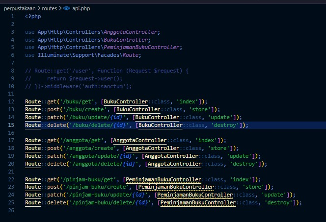
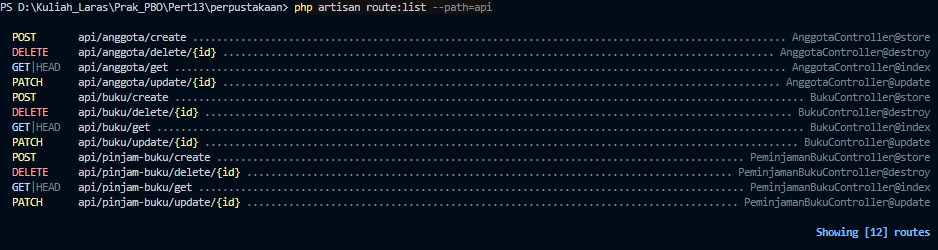

# API Sistem Perpustakaan — Laravel 10

REST API sederhana untuk mengelola **buku**, **anggota**, dan **peminjaman buku**.
Peminjaman otomatis mengurangi stok buku, dan pengembalian otomatis menambahnya kembali.

## 1. Identitas

| | |
|---|---|
| **Nama** | `[LARASATI DEWI]` |
| **NPM** | `[4525210037]` |

## 2. Kelas

`[A]`

---

## 3. Panduan Instalasi

### 3.1 Prasyarat

| Kebutuhan | Keterangan |
|---|---|
| PHP | 8.1 atau lebih baru (ekstensi `pdo_mysql`, `mbstring`, `openssl`, `fileinfo` aktif) |
| Composer | 2.x |
| MySQL | XAMPP / Laragon / MySQL Server |
| Git | terbaru |
| Klien API | Postman atau browser (untuk route GET) |

Cek versi:

```bash
php -v
composer -V
```

### 3.2 Langkah instalasi

**1. Clone repositori dan masuk ke folder proyek**

```bash
git clone [URL-REPOSITORI-ANDA]
cd [NAMA-FOLDER-PROYEK]
```

**2. Pasang dependensi**

```bash
composer install
```

**3. Salin berkas `.env`**

```bash
# Windows (CMD)
copy .env.example .env

# Linux / macOS / Git Bash
cp .env.example .env
```

**4. Generate application key**

```bash
php artisan key:generate
```

**5. Buat database MySQL**

Nyalakan MySQL (XAMPP Control Panel → Start pada MySQL), buka phpMyAdmin, lalu buat database:

```sql
CREATE DATABASE perpustakaan CHARACTER SET utf8mb4 COLLATE utf8mb4_unicode_ci;
```

**6. Atur koneksi database di `.env`**

```env
DB_CONNECTION=mysql
DB_HOST=127.0.0.1
DB_PORT=3306
DB_DATABASE=perpustakaan
DB_USERNAME=root
DB_PASSWORD=
```

**7. Jalankan migrasi dan seeder**

```bash
php artisan migrate:fresh --seed
```

Perintah ini membuat tabel `buku`, `anggota`, dan `peminjaman_buku`, lalu mengisi data awal: 1 buku tetap (*Laskar Pelangi*) + 20 buku acak, serta 1 anggota tetap (*Budi Santoso*, `AGT-0001`) + 15 anggota acak.

### 3.3 Struktur tabel

| Tabel | Kolom utama |
|---|---|
| `buku` | `id`, `isbn` (unik), `nama_penulis`, `title`, `jumlah_eksamplar` |
| `anggota` | `id`, `id_anggota` (kode unik, mis. `AGT-0001`), `nama_anggota` |
| `peminjaman_buku` | `id`, `id_anggota` (FK), `id_buku` (FK), `tanggal_pinjam`, `tanggal_pengembalian` (boleh kosong) |

---

## 4. Panduan Menjalankan Laravel

```bash
php artisan serve
```

Server berjalan di `http://127.0.0.1:8000`. Hentikan dengan `Ctrl + C`.

Halaman `/` hanya menampilkan halaman bawaan Laravel. Seluruh endpoint API berada di bawah `/api`.

**Cek cepat:** buka `http://127.0.0.1:8000/api/buku/get` di browser. Hasilnya harus berupa JSON berisi `"status": true` dan daftar buku.

### Menjalankan test (opsional)

Test memakai `RefreshDatabase`, yang **menghapus semua tabel** pada database yang aktif. Karena itu gunakan database terpisah:

1. Buat database `perpustakaan_test` di phpMyAdmin.
2. Di `phpunit.xml`, aktifkan dan ubah dua baris berikut:

```xml
<env name="DB_CONNECTION" value="mysql"/>
<env name="DB_DATABASE" value="perpustakaan_test"/>
```

3. Jalankan:

```bash
php artisan test
```

### Masalah umum

| Gejala | Solusi |
|---|---|
| `No application encryption key` | `copy .env.example .env` lalu `php artisan key:generate` |
| `Base table or view not found` | `php artisan migrate:fresh --seed` |
| `could not find driver` | Aktifkan `extension=pdo_mysql` di `php.ini`, lalu restart terminal |
| `Connection refused` | MySQL belum menyala; start dari XAMPP Control Panel |
| `"data": []` padahal sudah migrate | Seeder belum jalan; pastikan `DatabaseSeeder` memanggil `AnggotaSeeder` dan `BukuSeeder`, lalu `php artisan migrate:fresh --seed` |
| Validasi gagal malah redirect, bukan JSON | Tambahkan header `Accept: application/json` di Postman |
| Perubahan kode tidak terasa | `php artisan optimize:clear` |

---

## 5. Screenshot Route (`routes/api.php`)

### 5.1 Isi berkas `routes/api.php`



### 5.2 Hasil `php artisan route:list --path=api`

```bash
php artisan route:list --path=api
```



### 5.3 Ringkasan route

Seluruh URI berawalan `/api`.

| No | Method | URI | Controller@method | Fungsi |
|---|---|---|---|---|
| 1 | GET | `/api/buku/get` | `BukuController@index` | Daftar semua buku |
| 2 | POST | `/api/buku/create` | `BukuController@store` | Tambah buku |
| 3 | PATCH | `/api/buku/update/{id}` | `BukuController@update` | Ubah data buku |
| 4 | DELETE | `/api/buku/delete/{id}` | `BukuController@destroy` | Hapus buku |
| 5 | GET | `/api/anggota/get` | `AnggotaController@index` | Daftar semua anggota |
| 6 | POST | `/api/anggota/create` | `AnggotaController@store` | Tambah anggota |
| 7 | PATCH | `/api/anggota/update/{id}` | `AnggotaController@update` | Ubah data anggota |
| 8 | DELETE | `/api/anggota/delete/{id}` | `AnggotaController@destroy` | Hapus anggota |
| 9 | GET | `/api/pinjam-buku/get` | `PeminjamanBukuController@index` | Daftar peminjaman (beserta anggota dan buku) |
| 10 | POST | `/api/pinjam-buku/create` | `PeminjamanBukuController@store` | Catat peminjaman, stok buku berkurang 1 |
| 11 | PATCH | `/api/pinjam-buku/update/{id}` | `PeminjamanBukuController@update` | Ubah peminjaman; mengisi tanggal pengembalian menambah stok 1 |
| 12 | DELETE | `/api/pinjam-buku/delete/{id}` | `PeminjamanBukuController@destroy` | Hapus peminjaman; stok dikembalikan bila belum dikembalikan |

---

## 6. Percobaan Hasil API per Route

> **Cara menguji:** gunakan Postman dengan header `Accept: application/json`. Untuk POST dan PATCH, pilih **Body → raw → JSON**.
> Untuk tiap percobaan, tempel screenshot dan salin respons JSON asli ke blok yang disediakan.
> Nilai `id` pada body adalah `id` angka dari tabel (1, 2, dst.), bukan kode seperti `AGT-0001` atau ISBN.

### 6.1 Buku

#### 6.1.1 `GET /api/buku/get`

```
GET http://127.0.0.1:8000/api/buku/get
```

**Status yang diharapkan:** `200 OK`

**Respons:**

```json
[{
  "status": true,
  "data": [
    {
      "id": 1,
      "isbn": "978-602-03-2478-4",
      "nama_penulis": "Andrea Hirata",
      "title": "Laskar Pelangi",
      "jumlah_eksamplar": 10,
      "created_at": "2026-11-28T13:53:11.000000Z",
      "updated_at": "2026-11-28T13:53:11.000000Z"
    },
    {
      "id": 2,
      "isbn": "9781025263182",
      "nama_penulis": "Marcelina Pacocha",
      "title": "Harum consequatur neque dolor autem.",
      "jumlah_eksamplar": 20,
      "created_at": "2026-11-28T13:53:11.000000Z",
      "updated_at": "2026-11-28T13:53:11.000000Z"
    },
    {
      "id": 3,
      "isbn": "9789152832127",
      "nama_penulis": "Payton Gerlach II",
      "title": "Amet maiores.",
      "jumlah_eksamplar": 1,
      "created_at": "2026-11-28T13:53:11.000000Z",
      "updated_at": "2026-11-28T13:53:11.000000Z"
    },
    {
      "id": 4,
      "isbn": "9792910669071",
      "nama_penulis": "Deonte Rohan V",
      "title": "Natus optio est.",
      "jumlah_eksamplar": 13,
      "created_at": "2026-11-28T13:53:11.000000Z",
      "updated_at": "2026-11-28T13:53:11.000000Z"
    },
    {
      "id": 5,
      "isbn": "9793680719096",
      "nama_penulis": "Mona Collins",
      "title": "Nihil dolorum a.",
      "jumlah_eksamplar": 16,
      "created_at": "2026-11-28T13:53:11.000000Z",
      "updated_at": "2026-11-28T13:53:11.000000Z"
    },
    {
      "id": 6,
      "isbn": "9785575419969",
      "nama_penulis": "Eldon Von",
      "title": "Dolorem consequuntur molestiae.",
      "jumlah_eksamplar": 20,
      "created_at": "2026-11-28T13:53:11.000000Z",
      "updated_at": "2026-11-28T13:53:11.000000Z"
    },
    {
      "id": 7,
      "isbn": "9795163919818",
      "nama_penulis": "Linnie Purdy",
      "title": "Eius sint ut.",
      "jumlah_eksamplar": 13,
      "created_at": "2026-11-28T13:53:11.000000Z",
      "updated_at": "2026-11-28T13:53:11.000000Z"
    },
    {
      "id": 8,
      "isbn": "9795342412222",
      "nama_penulis": "Genoveva Stamm I",
      "title": "Perspiciatis sed similique vel corporis.",
      "jumlah_eksamplar": 11,
      "created_at": "2026-11-28T13:53:11.000000Z",
      "updated_at": "2026-11-28T13:53:11.000000Z"
    },
    {
      "id": 9,
      "isbn": "9785149769360",
      "nama_penulis": "Dr. Corene Schmidt II",
      "title": "Consequatur provident ducimus minus.",
      "jumlah_eksamplar": 2,
      "created_at": "2026-11-28T13:53:11.000000Z",
      "updated_at": "2026-11-28T13:53:11.000000Z"
    },
    {
      "id": 10,
      "isbn": "9791648787750",
      "nama_penulis": "Miss Mazie Reynolds",
      "title": "Aut in ea.",
      "jumlah_eksamplar": 4,
      "created_at": "2026-11-28T13:53:11.000000Z",
      "updated_at": "2026-11-28T13:53:11.000000Z"
    },
    {
      "id": 11,
      "isbn": "9795920912779",
      "nama_penulis": "Prof. Zander Kunze",
      "title": "Nisi veritatis molestias.",
      "jumlah_eksamplar": 17,
      "created_at": "2026-11-28T13:53:11.000000Z",
      "updated_at": "2026-11-28T13:53:11.000000Z"
    },
    {
      "id": 12,
      "isbn": "9791972852339",
      "nama_penulis": "Prof. Grace Welch",
      "title": "Est dolores voluptas.",
      "jumlah_eksamplar": 3,
      "created_at": "2026-11-28T13:53:11.000000Z",
      "updated_at": "2026-11-28T13:53:11.000000Z"
    },
    {
      "id": 13,
      "isbn": "9793544163997",
      "nama_penulis": "Corrine Huel IV",
      "title": "Sit sequi magni et.",
      "jumlah_eksamplar": 1,
      "created_at": "2026-11-28T13:53:11.000000Z",
      "updated_at": "2026-11-28T13:53:11.000000Z"
    },
    {
      "id": 14,
      "isbn": "9794047641593",
      "nama_penulis": "Ludie Jacobs",
      "title": "Minus error quis.",
      "jumlah_eksamplar": 17,
      "created_at": "2026-11-28T13:53:11.000000Z",
      "updated_at": "2026-11-28T13:53:11.000000Z"
    },
    {
      "id": 15,
      "isbn": "9794503697379",
      "nama_penulis": "Prof. Autumn Morar",
      "title": "Illo aut aut.",
      "jumlah_eksamplar": 8,
      "created_at": "2026-11-28T13:53:11.000000Z",
      "updated_at": "2026-11-28T13:53:11.000000Z"
    },
    {
      "id": 16,
      "isbn": "9798615867019",
      "nama_penulis": "Yadira Bode",
      "title": "Voluptate minima debitis sit.",
      "jumlah_eksamplar": 1,
      "created_at": "2026-11-28T13:53:11.000000Z",
      "updated_at": "2026-11-28T13:53:11.000000Z"
    },
    {
      "id": 17,
      "isbn": "9786073114684",
      "nama_penulis": "Clifton Schmidt",
      "title": "Expedita error neque.",
      "jumlah_eksamplar": 17,
      "created_at": "2026-11-28T13:53:11.000000Z",
      "updated_at": "2026-11-28T13:53:11.000000Z"
    },
    {
      "id": 18,
      "isbn": "9780695489618",
      "nama_penulis": "Kamille Mohr Jr.",
      "title": "Accusamus recusandae nisi.",
      "jumlah_eksamplar": 1,
      "created_at": "2026-11-28T13:53:11.000000Z",
      "updated_at": "2026-11-28T13:53:11.000000Z"
    },
    {
      "id": 19,
      "isbn": "9795385141240",
      "nama_penulis": "Mrs. Joelle DuBuque DVM",
      "title": "Sed et eligendi quidem.",
      "jumlah_eksamplar": 15,
      "created_at": "2026-11-28T13:53:11.000000Z",
      "updated_at": "2026-11-28T13:53:11.000000Z"
    },
    {
      "id": 20,
      "isbn": "9789090633695",
      "nama_penulis": "Dr. Mortimer Heaney PhD",
      "title": "Sint sed nam error nostrum.",
      "jumlah_eksamplar": 20,
      "created_at": "2026-11-28T13:53:11.000000Z",
      "updated_at": "2026-11-28T13:53:11.000000Z"
    },
    {
      "id": 21,
      "isbn": "9782064288020",
      "nama_penulis": "Jalyn Effertz",
      "title": "Maxime impedit placeat delectus.",
      "jumlah_eksamplar": 5,
      "created_at": "2026-11-28T13:53:11.000000Z",
      "updated_at": "2026-11-28T13:53:11.000000Z"
    }
  ]
}]
```

#### 6.1.2 `POST /api/buku/create`

```
POST http://127.0.0.1:8000/api/buku/create
```

Body:

```json
{
  "isbn": "978-602-1234-56-7",
  "title": "Uji Buku",
  "nama_penulis": "Penulis X",
  "jumlah_eksamplar": 5
}
```

**Status yang diharapkan:** `201 Created` — pesan `Buku berhasil ditambahkan`

**Respons:**

```json
[{
  "status": true,
  "message": "Buku berhasil ditambahkan",
  "data": {
    "isbn": "978-602-1234-56-7",
    "nama_penulis": "Penulis X",
    "title": "Uji Buku",
    "jumlah_eksamplar": 5,
    "updated_at": "2026-11-28T14:21:07.000000Z",
    "created_at": "2026-11-28T14:21:07.000000Z",
    "id": 22
  }
}]
```

#### 6.1.3 `PATCH /api/buku/update/{id}`

```
PATCH http://127.0.0.1:8000/api/buku/update/[ID-BUKU-UJI]
```

Body:

```json
{
  "isbn": "978-602-1234-56-7",
  "nama_penulis": "Penulis X Revisi",
  "jumlah_eksamplar": 8
}
```

**Status yang diharapkan:** `200 OK` — pesan `Data buku berhasil diperbarui`

**Respons:**

```json
[{
  "status": true,
  "message": "Data buku berhasil diperbarui",
  "data": {
    "id": 22,
    "isbn": "978-602-1234-56-7",
    "nama_penulis": "Penulis X Revisi",
    "title": "Uji Buku",
    "jumlah_eksamplar": 8,
    "created_at": "2026-11-28T14:21:07.000000Z",
    "updated_at": "2026-11-28T14:24:26.000000Z"
  }
}]
```

#### 6.1.4 `DELETE /api/buku/delete/{id}`

```
DELETE http://127.0.0.1:8000/api/buku/delete/[ID-BUKU-UJI]
```

> Hapus buku uji yang dibuat di 6.1.2, bukan buku bawaan seeder. Menghapus buku ikut menghapus riwayat peminjamannya (`cascadeOnDelete`).

**Status yang diharapkan:** `200 OK` — pesan `Buku berhasil dihapus`

**Respons:**

```json
[{
  "status": true,
  "message": "Buku berhasil dihapus"
}]
```

---

### 6.2 Anggota

#### 6.2.1 `GET /api/anggota/get`

```
GET http://127.0.0.1:8000/api/anggota/get
```

**Status yang diharapkan:** `200 OK`

**Respons:**

```json
[{
  "status": true,
  "data": [
    {
      "id": 2,
      "id_anggota": "AGT-3224",
      "nama_anggota": "Hannah Casper",
      "created_at": "2026-11-28T13:53:11.000000Z",
      "updated_at": "2026-11-28T13:53:11.000000Z"
    },
    {
      "id": 3,
      "id_anggota": "AGT-1876",
      "nama_anggota": "Lonny Johnson Jr.",
      "created_at": "2026-11-28T13:53:11.000000Z",
      "updated_at": "2026-11-28T13:53:11.000000Z"
    },
    {
      "id": 4,
      "id_anggota": "AGT-3275",
      "nama_anggota": "Avis Reichel Jr.",
      "created_at": "2026-11-28T13:53:11.000000Z",
      "updated_at": "2026-11-28T13:53:11.000000Z"
    },
    {
      "id": 5,
      "id_anggota": "AGT-3608",
      "nama_anggota": "Toy Macejkovic",
      "created_at": "2026-11-28T13:53:11.000000Z",
      "updated_at": "2026-11-28T13:53:11.000000Z"
    },
    {
      "id": 6,
      "id_anggota": "AGT-0728",
      "nama_anggota": "Prof. Alyce Streich Jr.",
      "created_at": "2026-11-28T13:53:11.000000Z",
      "updated_at": "2026-11-28T13:53:11.000000Z"
    },
    {
      "id": 7,
      "id_anggota": "AGT-7729",
      "nama_anggota": "Lonnie Krajcik II",
      "created_at": "2026-11-28T13:53:11.000000Z",
      "updated_at": "2026-11-28T13:53:11.000000Z"
    },
    {
      "id": 8,
      "id_anggota": "AGT-3108",
      "nama_anggota": "Corrine Kemmer",
      "created_at": "2026-11-28T13:53:11.000000Z",
      "updated_at": "2026-11-28T13:53:11.000000Z"
    },
    {
      "id": 9,
      "id_anggota": "AGT-5206",
      "nama_anggota": "Vickie Tremblay",
      "created_at": "2026-11-28T13:53:11.000000Z",
      "updated_at": "2026-11-28T13:53:11.000000Z"
    },
    {
      "id": 10,
      "id_anggota": "AGT-8319",
      "nama_anggota": "Delphine Nitzsche",
      "created_at": "2026-11-28T13:53:11.000000Z",
      "updated_at": "2026-11-28T13:53:11.000000Z"
    },
    {
      "id": 11,
      "id_anggota": "AGT-2237",
      "nama_anggota": "Rodolfo Crist PhD",
      "created_at": "2026-11-28T13:53:11.000000Z",
      "updated_at": "2026-11-28T13:53:11.000000Z"
    },
    {
      "id": 12,
      "id_anggota": "AGT-3907",
      "nama_anggota": "Mr. Rex Bernier MD",
      "created_at": "2026-11-28T13:53:11.000000Z",
      "updated_at": "2026-11-28T13:53:11.000000Z"
    },
    {
      "id": 13,
      "id_anggota": "AGT-2309",
      "nama_anggota": "Bernadine Stroman",
      "created_at": "2026-11-28T13:53:11.000000Z",
      "updated_at": "2026-11-28T13:53:11.000000Z"
    },
    {
      "id": 14,
      "id_anggota": "AGT-6177",
      "nama_anggota": "Elmore Denesik",
      "created_at": "2026-11-28T13:53:11.000000Z",
      "updated_at": "2026-11-28T13:53:11.000000Z"
    },
    {
      "id": 15,
      "id_anggota": "AGT-9174",
      "nama_anggota": "Zelma Abbott",
      "created_at": "2026-11-28T13:53:11.000000Z",
      "updated_at": "2026-11-28T13:53:11.000000Z"
    },
    {
      "id": 16,
      "id_anggota": "AGT-5290",
      "nama_anggota": "Delores McLaughlin IV",
      "created_at": "2026-11-28T13:53:11.000000Z",
      "updated_at": "2026-11-28T13:53:11.000000Z"
    },
    {
      "id": 1,
      "id_anggota": "AGT-0001",
      "nama_anggota": "Budi Santoso",
      "created_at": "2026-11-28T13:53:10.000000Z",
      "updated_at": "2026-11-28T13:53:10.000000Z"
    }
  ]
}]
```

#### 6.2.2 `POST /api/anggota/create`

```
POST http://127.0.0.1:8000/api/anggota/create
```

Body:

```json
{
  "id_anggota": "AGT-0100",
  "nama_anggota": "Siti Aminah"
}
```

**Status yang diharapkan:** `201 Created` — pesan `Anggota berhasil ditambahkan`

**Respons:**

```json
[{
  "status": true,
  "message": "Anggota berhasil ditambahkan",
  "data": {
    "id_anggota": "AGT-0100",
    "nama_anggota": "Siti Aminah",
    "updated_at": "2026-11-28T14:28:44.000000Z",
    "created_at": "2026-11-28T14:28:44.000000Z",
    "id": 17
  }
}]
```

#### 6.2.3 `PATCH /api/anggota/update/{id}`

```
PATCH http://127.0.0.1:8000/api/anggota/update/[ID-ANGGOTA-UJI]
```

Body:

```json
{
  "id_anggota": "AGT-0100",
  "nama_anggota": "Siti Aminah Putri"
}
```

**Status yang diharapkan:** `200 OK` — pesan `Data anggota berhasil diperbarui`

**Respons:**

```json
[TEMPEL RESPONS JSON]
```

#### 6.2.4 `DELETE /api/anggota/delete/{id}`

```
DELETE http://127.0.0.1:8000/api/anggota/delete/[ID-ANGGOTA-UJI]
```


**Status yang diharapkan:** `200 OK` — pesan `Anggota berhasil dihapus`

**Respons:**

```json
[{
  "status": true,
  "message": "Anggota berhasil dihapus"
}]
```

---

### 6.3 Peminjaman Buku

#### 6.3.1 `POST /api/pinjam-buku/create`

Catat stok buku sebelum meminjam (cek lewat `GET /api/buku/get`): `[STOK AWAL]`

```
POST http://127.0.0.1:8000/api/pinjam-buku/create
```

Body:

```json
{
  "id_anggota": 1,
  "id_buku": 1,
  "tanggal_pinjam": "2026-11-28"
}
```

**Status yang diharapkan:** `201 Created` — pesan `Peminjaman buku berhasil dicatat`

**Respons:**

```json
[{
  "status": true,
  "message": "Peminjaman buku berhasil dicatat",
  "data": {
    "id_anggota": 1,
    "id_buku": 1,
    "tanggal_pinjam": "2026-11-28T00:00:00.000000Z",
    "updated_at": "2026-11-28T14:30:42.000000Z",
    "created_at": "2026-11-28T14:30:42.000000Z",
    "id": 1,
    "anggota": {
      "id": 1,
      "id_anggota": "AGT-0001",
      "nama_anggota": "Budi Santoso",
      "created_at": "2026-11-28T13:53:10.000000Z",
      "updated_at": "2026-11-28T13:53:10.000000Z"
    },
    "buku": {
      "id": 1,
      "isbn": "978-602-03-2478-4",
      "nama_penulis": "Andrea Hirata",
      "title": "Laskar Pelangi",
      "jumlah_eksamplar": 9,
      "created_at": "2026-11-28T13:53:11.000000Z",
      "updated_at": "2026-11-28T14:30:42.000000Z"
    }
  }
}]
```

#### 6.3.2 `GET /api/pinjam-buku/get`

```
GET http://127.0.0.1:8000/api/pinjam-buku/get
```


**Status yang diharapkan:** `200 OK` — setiap data memuat objek `anggota` dan `buku`

**Respons:**

```json
[{
  "status": true,
  "data": [
    {
      "id": 1,
      "id_anggota": 1,
      "id_buku": 1,
      "tanggal_pinjam": "2026-11-28T00:00:00.000000Z",
      "tanggal_pengembalian": null,
      "created_at": "2026-11-28T14:30:42.000000Z",
      "updated_at": "2026-11-28T14:30:42.000000Z",
      "anggota": {
        "id": 1,
        "id_anggota": "AGT-0001",
        "nama_anggota": "Budi Santoso",
        "created_at": "2026-11-28T13:53:10.000000Z",
        "updated_at": "2026-11-28T13:53:10.000000Z"
      },
      "buku": {
        "id": 1,
        "isbn": "978-602-03-2478-4",
        "nama_penulis": "Andrea Hirata",
        "title": "Laskar Pelangi",
        "jumlah_eksamplar": 9,
        "created_at": "2026-11-28T13:53:11.000000Z",
        "updated_at": "2026-11-28T14:30:42.000000Z"
      }
    }
  ]
}]
```

#### 6.3.3 `PATCH /api/pinjam-buku/update/{id}` — pengembalian buku

```
PATCH http://127.0.0.1:8000/api/pinjam-buku/update/[ID-PEMINJAMAN]
```

Body:

```json
{
  "tanggal_pengembalian": "2026-12-05"
}
```

**Status yang diharapkan:** `200 OK` — pesan `Data peminjaman berhasil diperbarui`

**Respons:**

```json
[{
  "status": true,
  "message": "Data peminjaman berhasil diperbarui",
  "data": {
    "id": 1,
    "id_anggota": 1,
    "id_buku": 1,
    "tanggal_pinjam": "2026-11-28T00:00:00.000000Z",
    "tanggal_pengembalian": "2026-12-05T00:00:00.000000Z",
    "created_at": "2026-11-28T14:30:42.000000Z",
    "updated_at": "2026-11-28T14:38:28.000000Z",
    "anggota": {
      "id": 1,
      "id_anggota": "AGT-0001",
      "nama_anggota": "Budi Santoso",
      "created_at": "2026-11-28T13:53:10.000000Z",
      "updated_at": "2026-11-28T13:53:10.000000Z"
    },
    "buku": {
      "id": 1,
      "isbn": "978-602-03-2478-4",
      "nama_penulis": "Andrea Hirata",
      "title": "Laskar Pelangi",
      "jumlah_eksamplar": 10,
      "created_at": "2026-11-28T13:53:11.000000Z",
      "updated_at": "2026-11-28T14:38:28.000000Z"
    }
  }
}]
```

#### 6.3.4 `DELETE /api/pinjam-buku/delete/{id}`

```
DELETE http://127.0.0.1:8000/api/pinjam-buku/delete/[ID-PEMINJAMAN]
```

**Status yang diharapkan:** `200 OK` — pesan `Data peminjaman berhasil dihapus`

**Respons:**

```json
[{
  "status": true,
  "message": "Data peminjaman berhasil dihapus"
}]
```

---

### 6.4 Percobaan Gagal (Validasi)

#### 6.4.1 ISBN duplikat — `POST /api/buku/create`

Kirim ulang body dari 6.1.2 untuk ISBN yang sudah ada.

**Status yang diharapkan:** `422 Unprocessable Content` (kesalahan pada `isbn`)

```json
[{
  "message": "The isbn has already been taken.",
  "errors": {
    "isbn": [
      "The isbn has already been taken."
    ]
  }
}]
```

#### 6.4.2 Anggota atau buku tidak ditemukan — `POST /api/pinjam-buku/create`

Body:

```json
{
  "id_anggota": 999,
  "id_buku": 999,
  "tanggal_pinjam": "2026-11-28"
}
```
**Status yang diharapkan:** `422` (kesalahan pada `id_anggota` dan `id_buku`)

```json
[{
  "message": "The selected id anggota is invalid. (and 1 more error)",
  "errors": {
    "id_anggota": [
      "The selected id anggota is invalid."
    ],
    "id_buku": [
      "The selected id buku is invalid."
    ]
  }
}]
```

#### 6.4.3 Stok buku kosong — `POST /api/pinjam-buku/create`

Buat dulu buku dengan `"jumlah_eksamplar": 0`, lalu pinjam buku tersebut.

**Status yang diharapkan:** `422` — pesan `Stok buku sedang kosong`

```json
[{
  "status": false,
  "message": "Stok buku sedang kosong"
}]
```

---

## 7. Hasil Test Otomatis (opsional)

```bash
php artisan test
```

Test pada `tests/Feature/PeminjamanBukuTest.php` memeriksa:
1. Meminjam buku berhasil dan stok berkurang.
2. Meminjam gagal bila stok kosong.
3. Mengembalikan buku menambah stok kembali.
4. Validasi gagal bila anggota atau buku tidak ditemukan.
